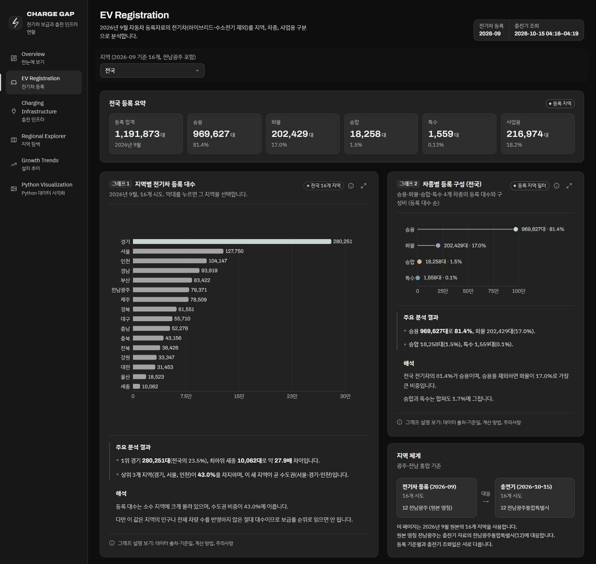
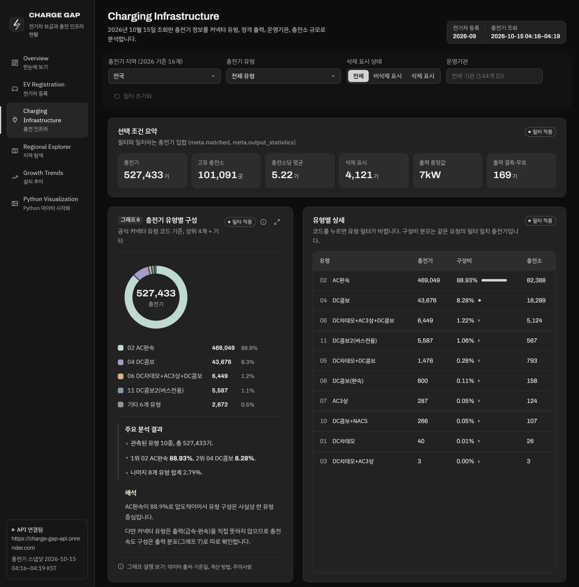
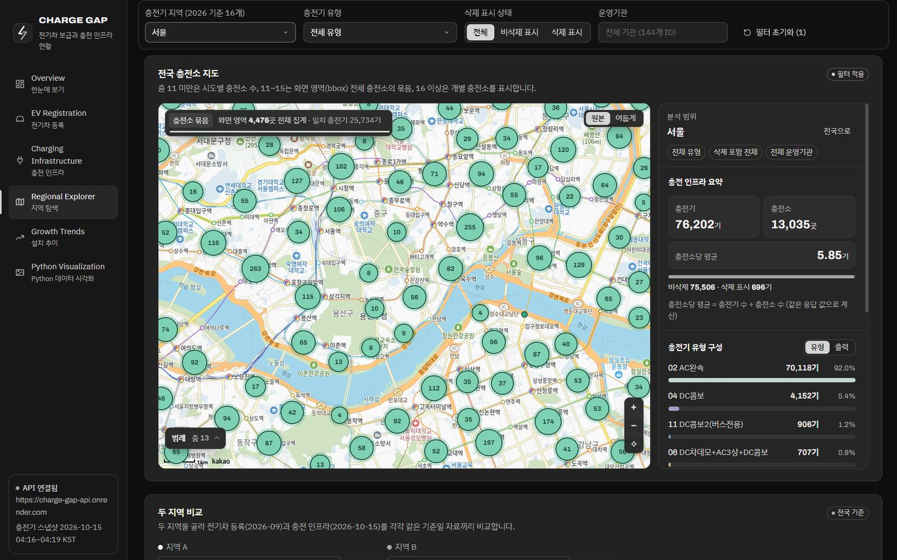
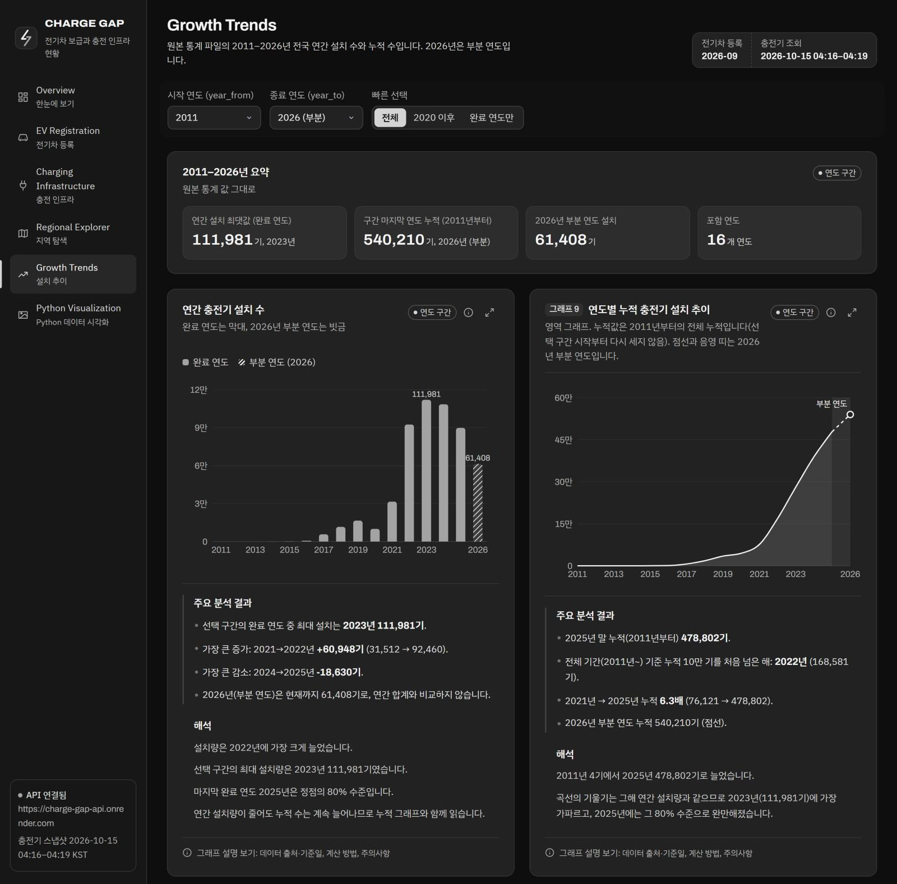
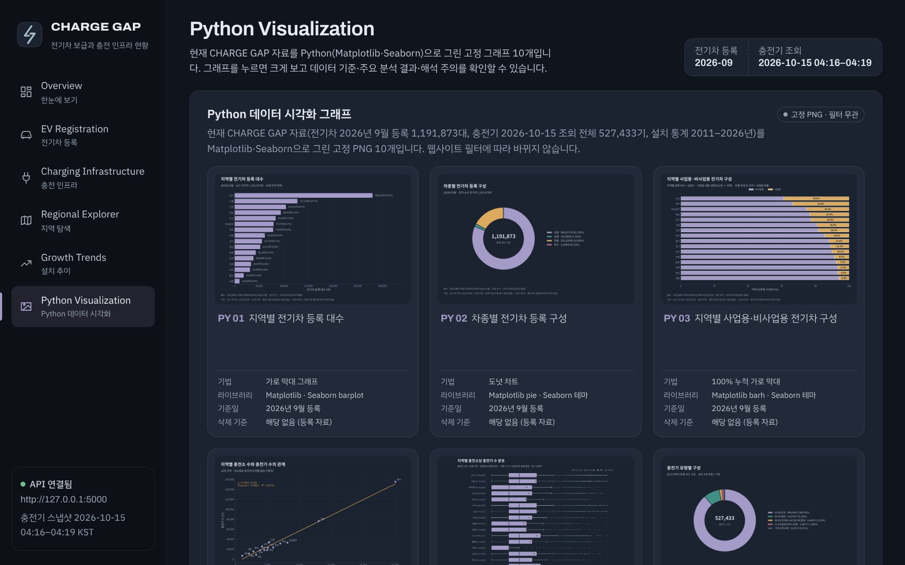
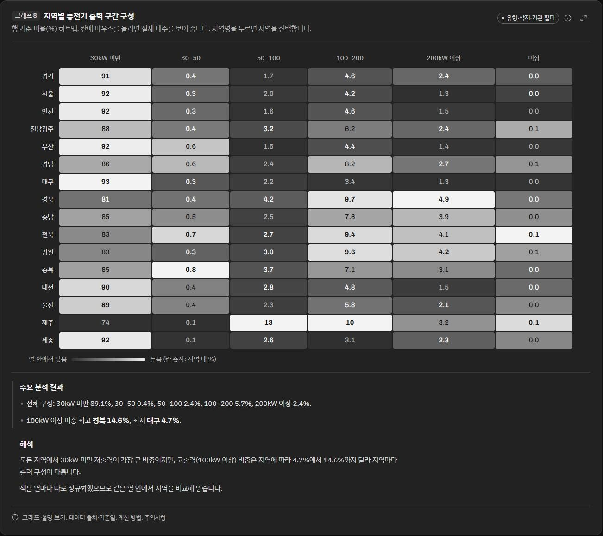
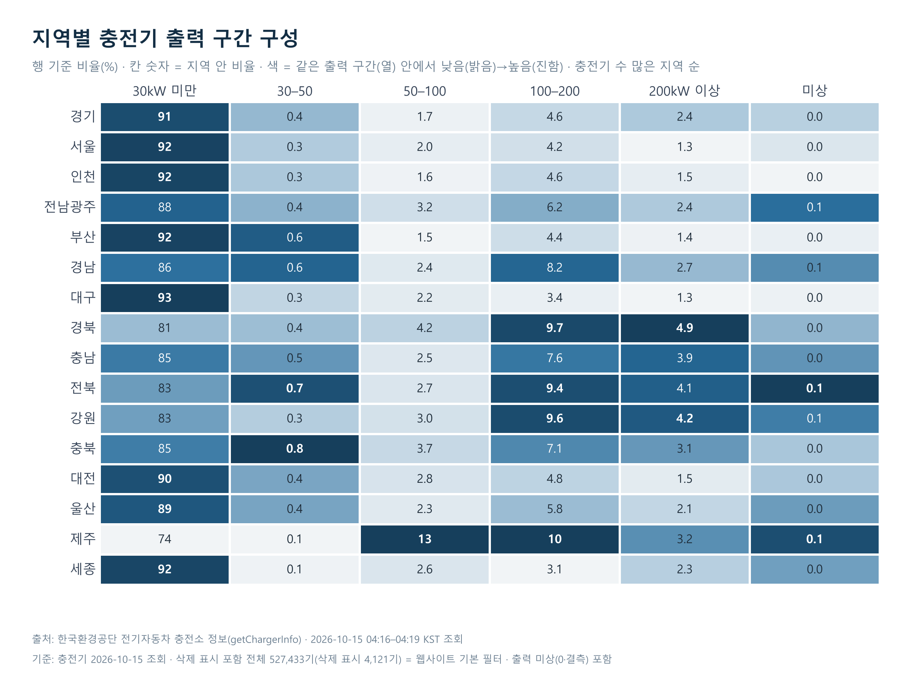
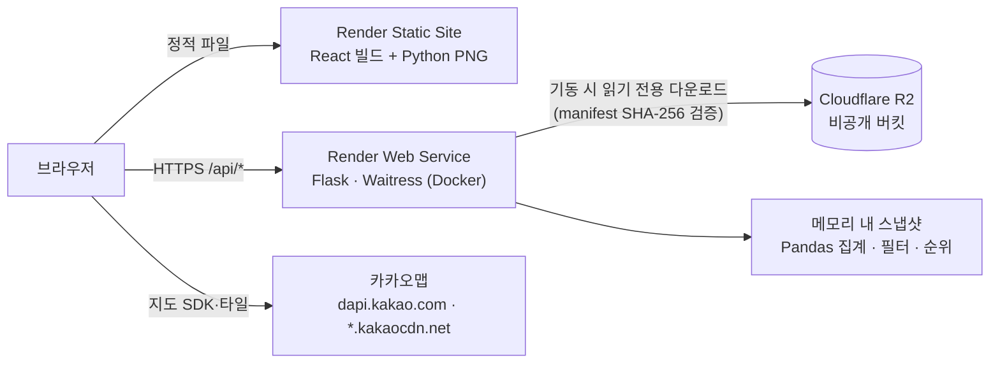

# CHARGE GAP

**전기차 보급과 충전 인프라의 지역별 격차를 분석하는 데이터 시각화 웹 대시보드**

국토교통부 전기차 등록 통계와 한국환경공단 충전기 정보 API로 16개 시도의 전기차 보급 현황과 충전 인프라 구성을 비교합니다. 충전기의 유형·출력·운영기관·충전소 규모가 지역마다 어떻게 다른지를 6개 페이지의 대화형 그래프, 카카오맵 지도, CSV·PDF 보고서로 보여 줍니다.

| 운영 사이트 | API | 소스 |
|---|---|---|
| [charge-gap.onrender.com](https://charge-gap.onrender.com) | [charge-gap-api.onrender.com](https://charge-gap-api.onrender.com/api/overview) | 이 저장소 (Public) |

> Render 무료 플랜이라 한동안 접속이 없으면 서버가 절전 상태가 됩니다. 첫 접속 때 서버가 데이터를 내려받아 준비하는 동안 몇 분까지 걸릴 수 있으며, 그동안 화면에 대기 안내가 표시되고 준비되면 자동으로 다시 불러옵니다.

<p align="center">
  
</p>
<p align="center"><sub>Overview · 기준 시점 띠, 핵심 KPI 4개, 주요 분석 발견 (운영 사이트, 2026-11-15 촬영)</sub></p>

## 목차

[프로젝트 소개](#프로젝트-소개) · [핵심 수치와 기준일](#핵심-수치와-기준일) · [화면 둘러보기](#화면-둘러보기) · [주요 분석 기능](#주요-분석-기능) · [웹 그래프와 Python 그래프](#웹-그래프-10개와-python-그래프-10개) · [데이터](#데이터) · [기술 스택](#기술-스택) · [시스템 구조](#시스템-구조) · [실행 방법](#실행-방법) · [검증 결과](#검증-결과) · [배포 상태](#배포-상태) · [문서](#문서)

## 프로젝트 소개

### 해결하려는 문제

전기차 등록 대수와 충전기 수는 각각 공개돼 있지만, **지역별 충전 인프라가 어떻게 구성돼 있는지**(급속 충전 비중, 충전소 규모, 운영기관 집중도 등)는 한눈에 비교하기 어렵습니다. CHARGE GAP은 공급 측 자료만으로 계산할 수 있는 구성 지표를 전국 기준값과 함께 보여 줍니다.

### 원칙과 차별점

- **기준 시점이 다른 자료를 서로 나누지 않습니다.** 전기차 등록(2026-09)과 충전기(2026-10-15)는 기준 시점이 달라, 두 수치로 충전 부족률·수요 충족률·전기차 1대당 충전기 수 같은 지표를 만들지 않습니다. 화면 상단의 기준 시점 띠에도 이 원칙을 표시합니다.
- **공급 측 구성 지표 5개를 전국 기준값과 비교합니다.** 100kW 이상 비중, 충전소당 평균 충전기, 유형별 구성, 운영기관 집중도(HHI), 삭제 표시 비중을 16개 지역별로 계산하고, 전국 기준값은 지역 비율의 평균이 아니라 전국 분자·분모를 합산해 구합니다.
- **원본 자료의 한계를 화면과 문서에 드러냅니다.** 운영기관은 원본의 운영기관 ID(`busiId`) 기준으로 묶고, 같은 ID가 같은 법인이라는 뜻은 아니라는 점을 함께 밝힙니다. 좌표 품질이 의심되는 충전소 644곳은 지도에서 고르면 안내가 나옵니다.
- **웹 그래프 10개를 Python으로 1:1 다시 구현해 수치를 대조했습니다.** 같은 그래프 종류·자료·집계 기준으로 Matplotlib·Seaborn PNG 10개를 만들고, 웹 API 값과 46개 항목, 웹 화면과 13개 항목을 대조했습니다.
- **지도는 줌에 따라 3단계로 표시합니다.** 시도 집계 → 화면 영역 격자 묶음 → 개별 충전소 순으로 바뀌며, 표시 수치는 서버 집계와 같습니다.

## 핵심 수치와 기준일

| 항목 | 규모 | 기준일 · 범위 |
|---|---|---|
| 전기차 등록 | **1,191,873대** | 2026년 9월 말 등록 기준, 16개 시도 |
| 충전기 | **527,433기** (삭제 표시 4,121기 · 비삭제 표시 523,312기) | 2026-10-15 04:16–04:19 KST 조회 |
| 충전소 | **101,091곳** (고유 충전소 ID 기준) | 충전기와 같은 조회 |
| 충전기 설치 추이 | 2011–2026년 연간·누적 | **2026년은 부분 연도** |
| 지역 체계 | 16개 시도 | 2026년 체계 (전남광주통합특별시 = 코드 12) |

> **두 자료의 기준일이 다릅니다.** 전기차 등록은 2026년 9월 말, 충전 인프라는 2026-10-15 조회 자료입니다. 16개 지역은 서로 대응하지만 같은 시점의 값이 아니므로, 이 프로젝트의 지표는 각 자료 안에서만 계산한 **구성 비교**입니다. 실제 충전 인프라 부족률이나 수요 충족률을 계산하지 않았습니다.

## 화면 둘러보기

6개 페이지 모두 운영 사이트에서 기본 필터 상태로 촬영했습니다.

<table>
  <tr>
    <td width="50%" valign="top"></td>
    <td width="50%" valign="top"></td>
  </tr>
  <tr>
    <td align="center"><b>EV Registration</b> · 지역별 등록 대수와 차종 구성</td>
    <td align="center"><b>Charging Infrastructure</b> · 유형·출력·운영기관 구조</td>
  </tr>
  <tr>
    <td width="50%" valign="top"></td>
    <td width="50%" valign="top"></td>
  </tr>
  <tr>
    <td align="center"><b>Regional Explorer</b> · 카카오맵 충전소 지도와 분석 패널</td>
    <td align="center"><b>충전 인프라 구성 격차</b> · Regional Explorer 안의 16개 지역 비교</td>
  </tr>
  <tr>
    <td width="50%" valign="top"></td>
    <td width="50%" valign="top"></td>
  </tr>
  <tr>
    <td align="center"><b>Growth Trends</b> · 연간·누적 설치 추이 (2026년 부분 연도)</td>
    <td align="center"><b>Python Visualization</b> · 웹 그래프 1~10의 Python 고정 PNG</td>
  </tr>
</table>

<sub>2026-11-15 운영 사이트 <a href="https://charge-gap.onrender.com">charge-gap.onrender.com</a>(프런트엔드 커밋 <code>133feb3</code>, API <code>9bbef7a</code> 배포본)에서 촬영했습니다. Claude 데스크톱 앱 내장 브라우저를 1440×900 화면으로 설정하고, 데이터·그래프·지도가 모두 불러와진 것(로딩·오류 표시 없음)을 확인한 뒤, 글자가 흐려지지 않도록 화면을 2배로 확대해 나눠 찍고 이어 붙였습니다(이미지 폭 1,600px = 화면 폭 1,440px). 긴 화면을 한 장에 담기 위해 촬영하는 동안만 왼쪽 메뉴 높이를 이미지 높이에 맞췄으며, 데이터·그래프·배치는 바꾸지 않았습니다. 구성 격차 이미지는 Regional Explorer 페이지의 해당 구역만 잘랐습니다. 지도의 카카오 로고·축척 표시는 그대로 두었습니다.</sub>

### 6개 페이지

| 페이지 | 경로 | 주요 내용 | 분석 목적 |
|---|---|---|---|
| **Overview** | `/` | 전기차·충전기·충전소·삭제 표시 KPI 4개, 기준 시점 띠, 주요 분석 발견, 누적 설치·유형 도넛·충전소-충전기 산점도·지역별 등록 그래프, 자료 해석 기준 | 전체 규모와 자료의 기준 시점을 한 화면에서 파악 |
| **EV Registration** | `/ev-registration` | 지역별 등록 대수, 차종 구성, 사업용·비사업용 비율(100% 누적·대수 전환), 지역별 등록 표 | 전기차 보급의 지역 분포와 구성 |
| **Charging Infrastructure** | `/charging-infrastructure` | 충전기 유형 구성, 정격 출력 히스토그램·KDE(로그 축), 충전소당 충전기 수 박스플롯, 운영기관 트리맵·목록 | 충전기의 유형·출력·운영기관 구조 |
| **Regional Explorer** | `/regional-explorer` | 충전소 지도, 두 지역 비교, **전국 충전 인프라 구성 격차**(5개 지표), 지역×출력 히트맵, 지역 표, 충전소 목록 | 지역 간 충전 인프라 구성 비교 |
| **Growth Trends** | `/growth-trends` | 연간 설치 막대, 누적 설치 추이, 연도 구간 선택(빠른 선택 포함), 연도별 표 | 2011년 이후 설치 추이(2026년은 부분 연도) |
| **Python Visualization** | `/python-visualization` | 웹 그래프 1\~10을 Matplotlib·Seaborn으로 다시 구현한 고정 PNG 10개 갤러리와 확대 보기(출처·기준일·지역 체계·삭제 기준·기법·라이브러리·사용 함수·웹 기본 필터, 분석 목적·결과, 해석 주의) | 웹 그래프와 같은 그래프 종류·자료·집계 기준을 Python으로 재현·검증 |

## 주요 분석 기능

- **필터와 URL 공유**: 충전기 지역·유형·삭제 표시 상태·운영기관과 등록 지역 필터를 URL 쿼리로 저장합니다. 페이지를 옮겨도 공통 필터가 유지되며, 잘못된 값은 무시하고 주소에서도 지웁니다.
- **지도 기반 충전소 탐색 (카카오맵)**: 줌 11 미만에서는 시도별 충전소 수를 원으로, 줌 11\~15에서는 화면 영역(bbox) 안의 **모든** 충전소를 서버가 격자로 집계한 묶음(`/api/locations/grid`)을, 줌 16 이상에서는 개별 충전소(`/api/locations`, 1,000곳 단위·3페이지까지 자동)를 표시합니다. 충전소를 누르면 지도 정보창과 오른쪽 분석 패널에 같은 수치(일치 충전기·비삭제·삭제 표시)가 나타납니다. 표시는 지도 위 캔버스 한 장에 그려 많은 충전소도 가볍게 움직입니다. 원본 좌표 품질이 의심되는 충전소를 고르면 정보창과 패널에 안내 한 줄이 함께 나옵니다(점 위치·색은 그대로).
- **지역×출력 히트맵**: 16개 지역의 출력 구성을 `/api/charger-output/regions` **한 번의 요청**으로 받아 그리며, 분석 패널·두 지역 비교도 같은 결과를 재사용합니다(지역 필터와 무관하게 16개 지역 표시, 선택 지역 행 강조).
- **두 지역 비교**: 전기차 등록(2026-09)과 충전 인프라(2026-10-15)를 **같은 기준일 자료끼리만** 비교합니다(차이·%p·배수·순위). 등록 대수와 충전기 수를 서로 나눈 지표는 만들지 않습니다.
- **16개 지역 충전 인프라 구성 격차**: 아래 5개 지표를 전국 기준값(전국 분자·분모 합산)과 비교하고, 순위·막대그래프·히트맵·선택 지역 요약·계산 근거를 함께 보여 줍니다. 공급 측 **구성 지표**이며 충전 수요나 부족률을 계산하지 않습니다.

  | 지표 | 계산 |
  |---|---|
  | 100kW 이상 비중 | 100kW 이상 충전기 ÷ 출력값이 확인된 충전기 |
  | 충전소당 평균 충전기 | 충전기 수 ÷ 고유 충전소 수 |
  | 충전기 유형별 구성 | 선택 유형 충전기 ÷ 지역 충전기 |
  | 운영기관 집중도(HHI) | 운영기관 ID별 점유율(%) 제곱의 합(0\~10,000) |
  | 삭제 표시 비중 | 삭제 표시 충전기 ÷ 삭제 상태 전체 충전기 |

- **내보내기**: 현재 지표·필터의 16개 지역 표를 **CSV**(UTF-8 BOM, Excel 한글 호환)로 저장하고, A4 3페이지 **PDF 보고서**(핵심 요약 · 16개 지역 비교 · 계산 방법·주의사항·출처)를 브라우저 인쇄로 저장합니다.
- **그래프별 분석 문단**: 주요 그래프마다 분석 목적·그래프 선택 이유·주요 결과·해석·주의사항을 실제 API 응답으로 계산해 표시합니다. 그래프는 확대 보기와 데이터 표를 지원합니다.

## 웹 그래프 10개와 Python 그래프 10개

웹사이트의 대화형 그래프 1\~10(Recharts)을 **같은 그래프 종류·자료·정렬·집계 기준**으로 Python(Matplotlib·Seaborn)에서 다시 구현한 것이 Python 그래프 PY01\~PY10입니다. 원본 CSV를 pandas로 다시 집계해 그렸으며, 웹 화면을 캡처하거나 색만 바꾼 이미지가 아닙니다. Python Visualization 페이지와 웹 그래프 확대 보기의 Python 탭이 이 PNG를 보여 줍니다.

> **필터에 따른 차이**
> - **웹 그래프**는 화면의 필터(지역·유형·삭제 표시·운영기관·연도 구간 등)에 따라 API에서 다시 계산됩니다. 그래프마다 반응하는 필터는 아래 표와 같습니다.
> - **Python 그래프(PNG)는 웹 기본 필터 기준으로 고정**됩니다. 웹사이트에서 필터를 바꿔도 PNG는 달라지지 않습니다.
> - **PY05 예외**: 충전소당 충전기 수 박스플롯(웹 그래프 5)은 삭제 표시 필터가 기본값 '전체'일 때도 **비삭제 표시 충전기(523,312기, 충전소 100,590곳)** 로 집계합니다. 그래서 PY05도 비삭제 기준이며, 나머지 충전기 그래프는 삭제 표시 포함 전체 527,433기 기준입니다.

| # | 그래프 | 웹 표현 (Recharts) | 웹 그래프가 반응하는 필터 | Python 기법 | Python PNG 고정 기준 |
|---|---|---|---|---|---|
| 1 · PY01 | 지역별 전기차 등록 대수 | 가로 막대 | 없음 (전국 16개 지역 고정) | 가로 막대 | 등록 2026-09, 16개 시도 |
| 2 · PY02 | 차종별 등록 구성 | 가로 롤리팝 | 등록 지역 | 가로 롤리팝 | 전국 합계, 등록 대수 순 |
| 3 · PY03 | 지역별 사업용·비사업용 전기차 구성 | 100% 누적 가로 막대, 대수 보기 전환 | 없음 (전국 16개 지역 고정) | 100% 누적 가로 막대 | 기본 "비율" 보기, 사업용 비율 내림차순 |
| 4 · PY04 | 지역별 충전소 수와 충전기 수의 관계 | 산점도·회귀선 | 유형·삭제 표시·운영기관 (지역 필터 제외) | 산점도 + 최소제곱 회귀선 | 전체 527,433기, 16개 시도 |
| 5 · PY05 | 충전소당 충전기 수 분포 | 지역별 박스플롯 | 지역·유형·삭제 표시·운영기관 ('전체'일 때 비삭제) | 박스플롯(로그 가로축) | **비삭제 523,312기** |
| 6 · PY06 | 충전기 유형별 구성 | 도넛 | 지역·유형·삭제 표시·운영기관 | 도넛(상위 4개 + 기타) | 전체 527,433기 |
| 7 · PY07 | 충전기 정격 출력 분포 | 로그 축 히스토그램·KDE | 지역·유형·삭제 표시·운영기관 | 히스토그램 + KDE | 전체 527,433기, 세로축 로그 |
| 8 · PY08 | 지역별 출력 구간 구성 | 행 기준 비율 히트맵 | 유형·삭제 표시·운영기관 (16개 지역 각각) | 히트맵(행 기준 구성비) | 전체 527,433기, 6개 구간 |
| 9 · PY09 | 연도별 누적 설치 추이 | 누적 영역 | 연도 구간 | 누적 영역 | 2011–2026 전체 (2026 부분 연도) |
| 10 · PY10 | 운영기관별 충전기 규모 | 트리맵 | 지역·유형·삭제 표시 (운영기관 필터 제외) | 트리맵(상위 20개 + 기타) | 전체 527,433기, 운영기관 ID 144개 |

연간 설치량 막대와 충전소 지도도 제공합니다(Python 대응 그래프 없음). [웹 그래프 구성·API 연결](frontend/docs/CHART_PLAN.md)

### 같은 그래프 비교: 웹 그래프 08과 PY08

<table>
  <tr>
    <td width="50%" valign="top"></td>
    <td width="50%" valign="top"></td>
  </tr>
  <tr>
    <td align="center"><b>웹 그래프 08</b> · 운영 사이트, 기본 필터 (필터를 바꾸면 다시 계산)</td>
    <td align="center"><b>PY08</b> · Seaborn <code>heatmap</code>, 웹 기본 필터 기준 고정 PNG</td>
  </tr>
</table>

두 그래프는 같은 자료(충전기 2026-10-15 조회, 삭제 표시 포함 527,433기)를 같은 규칙으로 집계합니다. 행은 충전기가 많은 지역 순, 칸 숫자는 지역 안의 출력 구간 비율(%)이고, 색은 같은 출력 구간(열) 안에서의 상대적 크기입니다. 16개 지역 × 6개 구간 96칸의 값이 같으며(검증 스크립트의 히트맵 96칸 대조 포함), 다른 점은 웹은 다크 테마의 회색 단계, PNG는 흰 배경의 파란 단계라는 표현 색뿐입니다. 웹 그래프는 운영 사이트에서 촬영한 이미지이고, PNG는 저장소 파일을 그대로 표시합니다.

<details>
<summary><b>Python 그래프 실제 사용 함수와 데이터 기준 (PY01–PY10)</b></summary>

| # | 그래프 (웹 그래프와 같은 제목) | 기법 | 실제 사용 함수 | 데이터 · 집계 기준 |
|---|---|---|---|---|
| PY01 | 지역별 전기차 등록 대수 | 가로 막대 | `seaborn.barplot(orient="h")`, `Axes.text` | 등록 CSV · 16개 시도 내림차순, 1위 강조 |
| PY02 | 차종별 등록 구성 (전국) | 가로 롤리팝 | `Axes.hlines`(줄기), `Axes.scatter`(끝 점), `Axes.annotate`(대수·구성비), `seaborn.set_theme` | 등록 CSV · 전국 합계, 승용·화물·승합·특수, 등록 대수 순 |
| PY03 | 지역별 사업용·비사업용 전기차 구성 | 100% 누적 가로 막대 | `Axes.barh(left=…)` 2계열 누적, `seaborn.set_theme` | 등록 CSV · 지역 합계 = 100%, 사업용 비율 내림차순(웹 기본 "비율" 보기) |
| PY04 | 지역별 충전소 수와 충전기 수의 관계 | 산점도 + 최소제곱 회귀선 | `seaborn.regplot(scatter=False, ci=None)`, `seaborn.scatterplot`, 검증용 `numpy.polyfit` | 충전기 CSV · 전체 527,433기, 16개 시도, 회귀식 −6,783 + 6.291 × 충전소 수(R² 0.972) |
| PY05 | 충전소당 충전기 수 분포 (지역별 박스플롯) | 박스플롯(로그 가로축) | `seaborn.boxplot(log_scale=True, showmeans=True)`, 이상치 `Axes.scatter`(점 크기 = 빈도) | 충전기 CSV · **비삭제 표시만**(웹은 필터 '전체'에서도 이 그래프만 비삭제 기준), 충전소 100,590곳, 중앙값→Q3→평균 내림차순 |
| PY06 | 충전기 유형별 구성 | 도넛(상위 4개 + 기타) | `Axes.pie(wedgeprops width)`, `seaborn.set_theme` | 충전기 CSV · 전체 527,433기, 공식 커넥터 유형 코드 |
| PY07 | 충전기 정격 출력 분포 | 히스토그램 + KDE(로그 가로축·로그 세로축) | `seaborn.histplot(weights, bins, kde=True)`(SciPy `gaussian_kde`, 대역폭 고정), `Axes.set_yscale("log")` | 충전기 CSV · 양수 출력 527,264기, log10 구간 폭 0.125 |
| PY08 | 지역별 충전기 출력 구간 구성 | 히트맵(행 기준 구성비) | `seaborn.heatmap(annot=…)`, `pandas.crosstab` | 충전기 CSV · 전체 527,433기, 6개 구간(미상 포함), 색은 열마다 상대값 |
| PY09 | 연도별 누적 충전기 설치 추이 | 누적 영역 | `Axes.stackplot`, `Axes.plot`, `Axes.axvspan` | 설치 통계 CSV · 완료 연도 영역, 2026년 부분 연도는 점선·음영 띠 |
| PY10 | 운영기관별 충전기 규모 | 트리맵(상위 20개 + 기타) | 웹 recharts Treemap 배치를 옮긴 `recharts_squarify`, `matplotlib.patches.Rectangle` | 충전기 CSV · 전체 527,433기, 운영기관 ID(busiId) 144개 |

- 생성: `scripts/create_web_matched_charts_2026.py` → `outputs/charts_web_matched_2026/` (PNG 10개, `metrics.json`, 검증 결과, 웹·Python 비교 이미지 `comparison/`)
- 페이지 반영: `scripts/build_python_charts_web_page.py`가 PNG를 바이트 그대로 `frontend/public/python-charts-web/`에 복사하고 `metrics.json`으로 표시용 `charts.json`을 만듭니다.
- 검증: `scripts/verify_web_matched_charts_2026.py`가 웹 코드와 같은 계산 규칙으로 API 값을 다시 계산해 대조합니다(46개). 로컬 웹 화면 글자·트리맵 칸 배치 대조 13개는 `outputs/charts_web_matched_2026/verification_screen.json`에 있습니다.
- 재현 방법과 고정 라이브러리 환경: [실행 방법 5](#5-python-그래프-재현-고정-환경)

</details>

<details>
<summary><b>Python 그래프 폴더 구분 (최종본과 보관용)</b></summary>

Python Visualization 페이지와 웹 그래프 상세 보기의 "Python 그래프 (고정)" 탭이 쓰는 최종본은 `frontend/public/python-charts-web/`입니다. 나머지 폴더는 다른 화면에서 쓰거나 보존용으로 둡니다.

| 폴더 | 구분 | 생성 | 데이터 기준 | 쓰는 곳 |
|---|---|---|---|---|
| `frontend/public/python-charts-web/` | **최종** (PY01–PY10, 흰 배경, 웹 그래프 1\~10 구현) | `scripts/create_web_matched_charts_2026.py` → `scripts/build_python_charts_web_page.py` | 전기차 2026년 9월(1,191,873대), 충전기 2026-10-15 전체 527,433기(PY05만 비삭제) | **Python Visualization 페이지 · 웹 그래프 상세 보기 Python 탭** |
| `outputs/charts_web_matched_2026/` | 최종본의 생성 결과 원본(같은 PNG) + `metrics.json`·검증 결과·비교 이미지 | `scripts/create_web_matched_charts_2026.py` | 위와 같음 | 보관·검증 기록 |
| `frontend/public/python-charts/` | 다크 테마 세트 (PY01–PY10) | `scripts/create_python_charts_2026.py` | 전기차 2026년 9월, 충전기 2026-10-15 전체 527,433기 | 사용처 없음 (보관) |
| `frontend/public/python-charts-original/` | 원본 PNG 복사본 (`outputs/charts/`와 바이트 동일) | 복사 | 전기차 2025년 12월(899,101대), 충전기 2026-10-15 | 사용처 없음 (보관) |
| `outputs/charts_2026_09_updated/` | 원본 디자인 재현 갱신본 (01·02·03·06·07·08·10) | `scripts/create_original_style_charts_2026.py` | 전기차 2026년 9월, 충전기 2026-10-15 | 사용처 없음 (보관) |
| `outputs/charts/` | 구버전 (01–10, 첫 그래프 세트) | 2026-10-14, 저장소 밖 초기 스크립트 (`reports/chart_verification.json`) | 전기차 2025년 12월(899,101대), 충전기 2026-10-15 | 백엔드 `/api/charts` 보존용 PNG |
| `outputs/charts_v2_report/` | 구버전 (보고서용 v2) | 2026-10-16, `scripts/create_report_charts_v2.py` | 전기차 2025년 12월(17개 시도), 충전기 2026-10-15 | 사용처 없음 (보관) |

구버전과 갱신본은 전기차 등록 기준월이나 그래프 종류가 최종본과 달라 수치·형태가 다릅니다. 예를 들어 03번은 최종본이 사업용 비율 순 100% 누적 가로 막대이고, `outputs/charts/`는 대수 누적 막대입니다.

</details>

## 데이터

### 데이터 출처와 기준일

| 자료 | 제공기관 · 작성기관, 자료명 | 자료 기준 · 수집 시점 · 이용 조건 |
|---|---|---|
| 전기차 등록 | [국토교통부 통계누리](https://stat.molit.go.kr/portal/cate/statMetaView.do?hFormId=1244&hRsId=58) · 작성기관 국토교통부, 「2026년 09월 자동차 등록자료 통계」 10.연료별_등록현황 (자동차등록현황보고) | 2026년 9월 말 등록 기준, 파일 저장 2026-10-20. 순수 전기차 1,191,873대, 전남광주 포함 16개 지역. **이용 조건 확인 중** (통계누리 저작권보호정책에 따라 출처 표시). 기존 2025-12 원본·고정 PNG 1\~3번(17개 시도)은 기록으로 보존 |
| 충전기·충전소 | 한국환경공단 ([공공데이터포털](https://www.data.go.kr/data/15076352/openapi.do)), 「전기자동차 충전소 정보」 getChargerInfo | 2026-10-15 조회(04:16–04:19 KST), 충전기 527,433기·고유 충전소 101,091곳, 16개 지역. **공공누리 제1유형(출처표시)** — 포털 이용허락범위에 명시 |
| 연도별 설치 | [무공해차 통합누리집](https://ev.or.kr/nportal/stats/statsDashboard.do) 데이터·통계 「충전기 설치 성장 추세」, 작성기관 원본 미기재 | 2011–2026, 2026년은 부분 연도. 집계 마감일 원본 미기재(당시 공식 화면 갱신 표시 2026-09-30), 파일 저장 2026-10-15. **이용 조건 확인 중.** 공식 화면은 이후 2026-10-31 갱신에서 과거 연도 수치까지 수정했으며(사유 미확인), 이 프로젝트는 당시 자료를 유지하므로 2026년 누적 540,210기 등은 현재 공식 최신값이 아님 |
| 참고용 지역 출력 통계 | `우리 지역 급속 충전 여건_2026-10-15.xlsx` | 원본 대조·분석용. 웹 출력 히트맵은 API 집계 사용. 배포·R2에 포함하지 않음. 기준일·공개 조건 추가 확인 필요 |
| 지도 배경 | [카카오맵 API](https://developers.kakao.com/docs/latest/ko/kakaomap/common) (Kakao) | 데이터가 아닌 지도 서비스. JavaScript 키를 등록 도메인에서만 사용, 지도 위 카카오 로고·저작권 표시를 가리지 않음. 무료 쿼터(지도 Web SDK 일 300,000건) 안에서 사용 |

### 해석 시 주의할 점

- 전기차 등록(2026-09)과 충전기(2026-10-15)는 **16개 지역이 대응하지만 기준 시점이 다릅니다.** 서로 다른 시점으로 부족률을 계산하거나 현재 스냅샷을 2025년 12월 현황으로 해석하지 않습니다.
- 전남광주통합특별시를 광주·전남으로 임의 분리하지 않습니다.
- 삭제 표시 4,121기·비삭제 523,312기를 구분하고, 비삭제를 실제 이용 가능 상태로 해석하지 않습니다.
- `statUpdDt`는 상태 갱신일시이며 설치일이 아닙니다.
- 누적 설치 수는 선택한 연도 구간과 관계없이 2011년부터의 전체 누적값입니다.

<details>
<summary><b>운영기관 집계 기준 (운영기관 ID, 2026-11-14 변경)</b></summary>

- 운영기관 순위·트리맵·HHI·두 지역 비교·PY10은 모두 **원본의 운영기관 ID(`busiId`) 기준**입니다.
- 표시 이름은 원본 기관명(`bnm`)입니다.
- 같은 ID의 서로 다른 운영기관명 표기(예: 파워큐브/파워큐브코리아, 한국전자금융/NICE인프라)는 하나로 세고, API의 `name_variants`에 보존합니다.
- 운영기관 ID는 144개, ID·운영기관명 조합은 342개입니다. 이전 조합 기준에서 전국 HHI 586이던 값이 ID 기준으로 811이 되었습니다.
- 같은 ID가 반드시 같은 법인이라는 뜻은 아닙니다. 등록 기관과 운영 법인이 다를 수 있는 충전기는 약 1.1%이며, 이를 분리해도 HHI는 최대 6점 이내로 달라집니다. 근거: [`reports/operator_id_grouping_2026-11-14.md`](reports/operator_id_grouping_2026-11-14.md)

</details>

<details>
<summary><b>충전소 좌표 품질 (2026-11-13 분석, 의심 644곳)</b></summary>

원본 대표 좌표 중 의심 근거가 있는 충전소가 **644곳, 충전기 3,322기**(전체의 0.63%)입니다.

- 주소 시군구에서 100km 넘게 떨어진 좌표: 182곳
- 여러 지역 충전소가 공유하거나 소수 1자리로 끊긴 대체·저정밀 좌표: 508곳
- 두 기준에 모두 해당하는 46곳은 한 번만 셌습니다.
- 644곳 모두가 실제 위치 오류로 확정된 것은 아닙니다. 외부 지오코딩 없이 주소·시군구 코드·이름·주변 충전소와의 모순으로만 판정했습니다. 대체·저정밀 좌표는 위치가 틀렸다기보다 대략적이라는 뜻입니다.
- 지역별 통계는 좌표가 아니라 지역 코드로 집계하므로 영향이 매우 작습니다. 지역 코드가 틀렸을 수 있는 곳은 4곳, 충전기 6기입니다.
- 영향은 주로 지도 위치에서 나타납니다. 일부 점이 다른 시도나 바다 위에 찍히거나 한 점에 겹칩니다.
- 판정 기준과 전체 목록: [`reports/coordinate_quality_2026-11-13.md`](reports/coordinate_quality_2026-11-13.md)

</details>

### 데이터 이용과 재배포 제한

**이 저장소에는 원본·가공 CSV와 Excel이 포함되지 않으며, 별도로 제공하지도 않습니다.** 사이트가 공개 주소에서 동작한다는 사실이 데이터와 파생 그래프·보고서의 공개 이용 허락이 확정되었다는 뜻은 아닙니다.

| 자료 | 이용 조건 (2026-11-14 공식 페이지 재확인) | 상태 |
|---|---|---|
| 충전기·충전소 (한국환경공단 API) | 공공데이터포털 이용허락범위 「공공저작물: 출처표시(제1유형)」 | 확인 |
| 전기차 등록 (통계누리) | 저작권보호정책은 통계정보의 자유로운 사용·재사용·재배포를 안내하면서, 자유이용 자료에는 공공누리 제1유형 표시를 붙여 개방하니 표시를 확인하라고 함. 해당 통계·첨부 목록 페이지에는 공공누리 표시가 없음 | **미확정** (허용 근거 강함) |
| 충전기 설치 추이 (무공해차 통합누리집) | 공개자료 목록(10건)은 공공누리 제1유형이지만 설치 추이 표는 그 목록에 없고, 데이터·통계 화면에는 이용 조건·공공누리 표시가 없음 | **미확정** (근거 부족) |
| 참고용 지역 출력 통계 Excel | 출처 이용 조건 미확인. 배포·R2에 포함하지 않아 공개되지 않음 | 미확인(비공개) |
| 파생 그래프·보고서 | 입력 자료 조건을 따름. 전기차 등록·설치 추이로 만든 그래프(PY01–03·PY09, 보존 PNG 1–3·9)는 해당 자료 조건이 확정되어야 함 | 일부 미확정 |
| 지도 배경 (카카오맵) | 데이터가 아닌 지도 서비스. 등록 도메인에서 JavaScript 키 사용, 지도 캡처에는 카카오 로고 유지 | 사용 조건 확인 |
| 코드 | 저장소에 LICENSE 파일 없음 | 소유자 결정 필요 |

API 포털에는 확인 시점에 공공누리 제1유형 출처표시 조건이 안내됐으나, 이것으로 Excel·파생 CSV·PNG·보고서 전체의 재배포 권리를 일괄 확정하지 않습니다. 각 원본의 이용 조건·제3자 권리·출처와 가공 사실 표기를 검토해야 합니다. **CSV·Excel의 공개 여부, 별도 데이터 제공 URL, 전달 방식과 담당자는 모두 미확정**입니다. 코드 공개 라이선스도 소유자가 별도 결정해야 합니다. 후보에 남은 PNG·보고서도 최종 권리·내용 검토 대상입니다. 격차 분석 CSV에는 이용 조건이 확인된 충전기 API 자료의 집계값만 들어가며, PDF 보고서는 전기차 등록 자료를 결합하지 않고 참고 출처로만 표기합니다. 전기차 등록·연도별 설치 자료의 **이용 조건은 아직 미확인**입니다. 상세 근거: [출처·이용 조건 확인 기록](docs/DATA_SOURCE_RIGHTS.md)

## 기술 스택

| 영역 | 기술 |
|---|---|
| Frontend | React · TypeScript · Vite · TanStack Query |
| Visualization | Recharts(웹) · Matplotlib · Seaborn(Python 그래프) |
| Map | 카카오맵 JavaScript SDK · Canvas 표시층(자체 구현) |
| Backend | Python · Flask · Waitress |
| Data Analysis | Pandas · NumPy |
| Deployment | Docker · Docker Compose · Nginx(로컬) · Render(Static Site + Web Service) |
| Storage | Cloudflare R2 (비공개 버킷, S3 호환) |

## 시스템 구조



| 구성 요소 | 역할 |
|---|---|
| **Render Static Site** | React 빌드(`frontend/dist`)와 Python 그래프 정적 파일을 제공합니다. 페이지 경로 5개(`/ev-registration` 등, `/python-visualization` 포함)는 `index.html`로 rewrite합니다. CSP 등 보안 헤더를 전송하며, CSP는 자체 파일·API와 카카오맵 SDK·지도 이미지 도메인만 허용합니다. |
| **Render Web Service** | Flask 조회 API **14개 경로**(JSON 13개 + PNG 1개, 지도용 `/api/locations/grid`와 히트맵용 `/api/charger-output/regions` 포함). 기동할 때 CSV를 읽은 고정 스냅샷으로 집계·필터·순위를 계산하고, 요청 값을 검증해 JSON 오류를 반환합니다. Render 무료 플랜 메모리(512MiB)에 맞춰 Waitress 1스레드로 실행합니다. |
| **Cloudflare R2** | CSV 3개·메타데이터·보존용 PNG 등 14개 파일을 비공개로 보관합니다. 백엔드만 읽기 전용 자격증명으로 접근하며, 프론트엔드 빌드에는 비밀값이 들어가지 않습니다. |

API 명세: [API_SPEC.md](backend/API_SPEC.md) · [openapi.json](backend/openapi.json). 환경변수 이름과 설정 절차는 [공개 배포 안내](docs/RENDER_DEPLOYMENT.md)에 있습니다(실제 값은 저장소에 기록하지 않습니다).

## 실행 방법

### 1. 데이터 준비 (필수)

**GitHub 저장소에는 실행용 데이터가 포함되지 않습니다.** `.gitignore`가 모든 CSV·Excel과 `.env`를 제외하므로, clone만으로는 실행되지 않습니다. 승인된 스냅샷을 아래 경로에 별도로 준비해야 합니다. 데이터 없이 시작하면 실패하며, 빈 폴더나 가짜 데이터를 대신 만들지 않습니다.

| 경로 | 용도 | 저장소 포함 |
|---|---|---|
| `data/processed/charger_info_clean.csv` | 전체 충전기, 약 240 MB | 제외 · 별도 준비 |
| `data/processed/ev_registration_by_region_2026_09.csv` | 전기차 등록 통계 | 제외 · 별도 준비 |
| `data/processed/charger_installation_trend.csv` | 연간·누적 설치 통계 | 제외 · 별도 준비 |
| `reports/chart_verification.json` | 보존용 PNG 메타데이터 | 포함 |
| `outputs/charts/` PNG 10개 | `/api/charts` 보존용 PNG | 포함 |

파일 목록과 SHA-256은 [`deploy/render/data-manifest.json`](deploy/render/data-manifest.json)에서 확인할 수 있습니다.

### 2. Docker Compose (로컬 전체 실행)

Docker Desktop(Linux 컨테이너) 또는 Docker Engine과 Compose v2가 필요합니다. 프로젝트 최상위 폴더에서:

```sh
docker compose up -d --build --wait --wait-timeout 240
```

접속: **http://localhost:18080** · 종료: `docker compose down`

구조는 `브라우저 :18080 → Nginx → /backend/ 프록시 → Waitress :5000`이며, CSV·PNG는 읽기 전용 바인드 마운트로 공급합니다. Compose 빌드에는 카카오맵 키를 전달하지 않으므로 **지도 자리에는 키 설정 안내가 표시**되고, 그래프·표·분석 패널은 그대로 동작합니다(지도까지 확인하려면 아래 개발 서버를 사용). Compose에는 인증키나 `env_file`이 없습니다. `.env`와 인증키를 컨테이너·빌드 인수·`VITE_*`로 전달하지 마세요. 자세한 내용: [Docker 검증 기록](docker/VALIDATION.md)

### 3. 개발 서버 (Python 3.12 · Node.js 24)

```powershell
# 터미널 1: 백엔드 (프로젝트 최상위 폴더에서)
cd backend
python -m venv .venv
.\.venv\Scripts\python.exe -m pip install -r requirements.lock.txt
.\.venv\Scripts\python.exe run.py

# 터미널 2: 프론트엔드
cd frontend
npm ci
npm run dev
```

웹 `http://localhost:5173`, API `http://127.0.0.1:5000`. Linux/macOS는 `python3 -m venv .venv`와 `.venv/bin/python`을 사용합니다. 자세한 내용: [백엔드](backend/README.md) · [프론트엔드](frontend/README.md)

**카카오맵 JavaScript 키 설정 (지도 표시에 필요)**

1. [카카오 Developers](https://developers.kakao.com/console/app)에서 앱을 만들고, 앱 설정의 **카카오맵 → 사용 설정**을 켭니다.
2. **앱 키**에서 **JavaScript 키**를 확인합니다. REST API 키·Admin 키는 사용하지 않습니다.
3. **플랫폼 → Web**(JavaScript SDK 도메인)에 실행 주소를 등록합니다: 로컬 `http://localhost:5173`, 배포 `https://charge-gap.onrender.com`.
4. `frontend/.env.example`을 `frontend/.env`로 복사하고 `VITE_KAKAO_MAP_KEY=<JavaScript 키>`를 적은 뒤 `npm run dev`를 다시 시작합니다. `frontend/.env`는 Git에서 제외됩니다.

JavaScript 키는 빌드 결과(JS)에 포함되어 브라우저에 공개되는 키이므로, 보호는 등록 도메인 제한으로 합니다. 키가 없거나 SDK를 불러오지 못하면 지도 자리에 원인 안내가 표시되고 나머지 화면은 그대로 동작합니다.

`npm run build`는 `VITE_API_BASE_URL`이 비어 있거나 localhost를 가리키면 **실패**합니다. 배포 빌드에는 실제 백엔드 HTTPS origin(또는 Compose의 `/backend`)을 지정하고, 로컬 미리보기 빌드만 `CHARGE_GAP_ALLOW_LOCAL_API_BUILD=1`을 함께 지정합니다.

### 4. Render 배포

Render Static Site(프론트엔드) + Docker Web Service(백엔드) + 비공개 R2 구성입니다. 환경변수 이름, SPA rewrite 5개, 보안 헤더, 배포 순서, 기동 실패 진단은 [공개 배포 안내](docs/RENDER_DEPLOYMENT.md)를 따릅니다. `render.yaml`은 자동 배포가 꺼져 있어(`autoDeployTrigger: 'off'`) push 뒤에 수동으로 배포해야 합니다.

- 정적 사이트 환경 변수: `VITE_API_BASE_URL`(백엔드 HTTPS origin), `VITE_KAKAO_MAP_KEY`(카카오 JavaScript 키, 값은 대시보드에만 입력), `NODE_VERSION=24`. VITE 값은 빌드할 때 들어가므로 바꾼 뒤에는 다시 빌드합니다.
- 새 API를 쓰는 프론트엔드를 배포할 때는 **백엔드를 먼저** 배포하고 API가 정상인지 확인한 뒤 프론트엔드를 배포합니다.

### 5. Python 그래프 재현 (고정 환경)

저장소의 PNG 10개(`outputs/charts_web_matched_2026/` = `frontend/public/python-charts-web/`)는 아래 환경에서 만들었습니다. 이 환경으로 다시 생성하면 **10개 모두 SHA-256까지 같은 PNG**가 나오는 것을 확인했습니다(2026-11-15, 새 가상환경).

| 항목 | 고정 값 |
|---|---|
| Python | 3.13 |
| 라이브러리 | [`scripts/requirements-web-matched-charts.txt`](scripts/requirements-web-matched-charts.txt): pandas 3.0.5 · numpy 2.5.3 · matplotlib 3.11.2 · seaborn 0.13.2 · scipy 1.18.1 · Pillow 13.0.0 |
| 글자 렌더링 | `text.hinting = 'no_hinting'` (스크립트의 `sns.set_theme` rc에 고정). 설치본마다 기본값이 달라, 고정하지 않으면 값·모양이 같아도 PNG 바이트가 달라집니다 |
| 글꼴 | 맑은 고딕 `malgun.ttf`·`malgunbd.ttf` (`--font-dir`로 지정하거나 `C:/Windows/Fonts`, `~/.fonts_cg`에서 찾음) |

`scripts/requirements-charts-v2.txt`는 보관용 보고서 그래프 스크립트(`create_report_charts_v2.py`) 전용이며 이 재현에는 쓰지 않습니다.

```sh
python3.13 -m venv .venv-charts
.venv-charts/bin/python -m pip install -r scripts/requirements-web-matched-charts.txt

# 저장소 PNG를 덮어쓰지 않도록 새 폴더에 생성 (--out-dir 기본값은 outputs/charts_web_matched_2026)
.venv-charts/bin/python scripts/create_web_matched_charts_2026.py \
  --data-dir data/processed --out-dir /tmp/charts_check --font-dir <맑은 고딕 폴더>

# 새로 만든 PNG의 SHA-256을 저장소 기록(metrics.json)과 비교
sha256sum /tmp/charts_check/*.png
# 웹 API 값과 대조 (백엔드 실행 중일 때)
.venv-charts/bin/python scripts/verify_web_matched_charts_2026.py --api http://127.0.0.1:5000 --dir /tmp/charts_check
```

웹 페이지용 파일은 `scripts/build_python_charts_web_page.py`가 `outputs/charts_web_matched_2026/`의 PNG를 `frontend/public/python-charts-web/`에 바이트 그대로 복사하고 `charts.json`을 만듭니다. 이 스크립트는 저장소 파일을 갱신하므로 그래프를 실제로 바꿀 때만 실행합니다.

## 검증 결과

최신 결과는 그래프 2 롤리팝 변경과 그래프 2·6 비율 표기(소수점 첫째 자리) 수정을 반영한 작업본에서 2026-11-25에 로컬로 실행한 것입니다. 그 아래 `133feb3` 표는 이전 기록이며, 다시 실행하지 않은 항목(접근성, `pip-audit`, gitleaks 등)은 그 표에만 있습니다. 더 이전 날짜의 기록은 [검증·배포 이력](docs/VERIFICATION_HISTORY.md)에 원문 그대로 있습니다.

### 로컬 테스트 (최신, 2026-11-25)

| 대상 | 명령 | 결과 |
|---|---|---|
| 백엔드 API · Render 기동 스크립트 | `python -m pytest backend/tests deploy/render/tests -q` | **321 passed** (backend 236 · deploy 85). Python 3.13과 Python 3.12 + `backend/requirements.lock.txt` 두 환경에서 같은 결과 |
| 데이터 수집기 | `python -m pytest test_collector.py -q` | **12 passed** |
| 프론트엔드 단위·회귀 | `frontend`에서 `npm test` | **170/170 통과** (29개 파일. 그래프 2·6 비율 표기 회귀 테스트 7개 추가) |
| TypeScript | `npx tsc --noEmit -p .`, `npx tsc -b --noEmit` | 오류 없음 |
| 프로덕션 빌드 | `VITE_API_BASE_URL=<HTTPS 주소> npm run build` | 성공 (API 주소가 비어 있으면 의도대로 실패) |
| Python 그래프 웹 API 대조 | `python scripts/verify_web_matched_charts_2026.py --api <로컬 API>` | **47/47 일치** (그래프 2 롤리팝 순서 항목 추가. 정렬, 대수·비율 표기, 회귀계수, 박스플롯 통계, 히스토그램 19개 구간·KDE, 히트맵 96칸, 설치 추이, 운영기관 상위 20개) |
| Python 그래프 화면 대조 | 로컬 웹 화면(기본 필터, 1600px)의 카드 글자·트리맵 칸 배치를 PNG 계산값과 비교 | **13/13 일치** |
| Python PNG 재생성 | 고정 환경으로 10개 재생성 후 SHA-256 비교 | **10/10 저장소·`metrics.json`과 동일** |
| 브라우저 회귀 (Playwright, 로컬 프로덕션 빌드) | `frontend/tests/*.browser.cjs` 18개 모듈 | **18/18 통과** (한 번의 전체 실행, `keyboard` 포함) |
| 의존성 취약점 | `npm audit` | 0건 |

### 이전 기록: 로컬 테스트 (커밋 `133feb3`, 2026-11-15)

"README 작업 중 재실행"은 당시 README를 쓰면서 다시 돌린 결과이고, "같은 날 앞서 실행"은 2026-11-15 L1\~L5 수정 검증 때 실행한 결과를 옮긴 것입니다.

| 대상 | 명령 | 결과 | 실행 |
|---|---|---|---|
| 백엔드 API · Render 기동 스크립트 | `python -m pytest backend/tests deploy/render/tests -q` | **321 passed** (backend 236 · deploy 85) | 2026-11-15 README 작업 중 재실행 |
| 프론트엔드 단위·회귀 | `frontend`에서 `npm test` | **163 passed** | 2026-11-15 README 작업 중 재실행 |
| TypeScript | `npx tsc --noEmit -p .` | 오류 없음 | 2026-11-15 README 작업 중 재실행 |
| 데이터 수집기 | `python -m unittest test_collector` | 12 passed | 2026-11-15 README 작업 중 재실행 |
| Python 그래프 웹 API 대조 | `python scripts/verify_web_matched_charts_2026.py --api <로컬 API>` | **46/46 일치** (정렬, 대수·비율 표기, 회귀계수, 박스플롯 통계, 히스토그램 19개 구간·KDE, 히트맵 96칸, 설치 추이, 운영기관 상위 20개) | 2026-11-15 README 작업 중 재실행 |
| Python 그래프 화면 대조 | 로컬 웹 화면(기본 필터, 1600px)의 카드 글자·트리맵 칸 배치를 PNG 계산값과 비교 | **13/13 일치** | 2026-11-15 같은 날 앞서 실행 |
| Python PNG 재생성 | 고정 환경(새 가상환경)으로 10개 재생성 후 SHA-256 비교 | **10/10 저장소·`metrics.json`과 동일** | 2026-11-15 같은 날 앞서 실행 |
| 브라우저 회귀 (Playwright, 로컬 프로덕션 빌드) | `frontend/tests/*.browser.cjs` 18개 모듈 | 첫 전체 실행 17/18 통과, `keyboard` 1회 시간 초과 → 단독 재실행 3/3 통과 | 2026-11-15 같은 날 앞서 실행 |
| 접근성 (axe-core 4.10.3, 1600px) | 6개 페이지 | `empty-table-header`·`landmark-unique` 0건. Recharts SVG의 `svg-img-alt`만 남음 | 2026-11-15 같은 날 앞서 실행 |
| 의존성 취약점 | `npm audit`, `pip-audit`(요구사항 파일 5개) | 0건 / 0건 | 2026-11-15 같은 날 앞서 실행 |
| 비밀값 검사 | gitleaks (L1\~L5 커밋 2개) | 0건 | 2026-11-15 같은 날 앞서 실행 |

### 운영 사이트 확인 (2026-11-15, 웹 `133feb3` · API `9bbef7a`)

| 항목 | 결과 |
|---|---|
| Render 배포 | Static Site `charge-gap`에 `133feb3` 수동 배포 성공(23.5초, Live). 백엔드는 재배포하지 않음 |
| 6개 페이지 | 모두 제목·그래프 표시, 오류 메시지 없음 |
| Python PNG | 10개 모두 2400px 폭으로 로드, 운영 사이트에서 받은 파일의 SHA-256이 저장소 원본과 10개 모두 같음. 카드 제목·메타 정보 10개 표시, 확대 창(08번) 열기·Esc 닫기 |
| 필터·API | Charging Infrastructure 지역(서울)·유형(DC콤보) 선택 시 URL에 반영되고 API 4개 200. Regional Explorer 지역 목록에서 경북 선택 시 지역 필터 변경, API 5개 200. 200이 아닌 API 응답 없음(연속 변경 때 취소된 이전 요청만 있음) |
| 히트맵 정렬·접근성 | 그래프 08 히트맵이 카드 안쪽 폭의 94%, 좌우 여백 같음(1024px 화면). 히트맵 빈 머리글 칸에 화면 낭독기용 "지역", 분석 결과 영역 이름이 서로 다름 |
| 카카오맵 | SDK 로드, 지도 타일 33개 모두 표시, 로고·축척 표시 |

### 알려진 문제와 미실행 검사

**알려진 문제**

- **운영 사이트 콘솔의 CSP 오류**: "Applying inline style violates … `style-src 'self'`" 오류가 나옵니다. 1건은 카카오맵 SDK(`kakao.js`)가 인라인 스타일을 넣으려다 차단된 것으로 확인했고(같은 SDK의 `eval` 차단 위반도 보안 이벤트로 잡힘), 지도는 정상 표시됩니다. 카카오 SDK를 불러오지 않는 Python Visualization 페이지 첫 로드 때 1건이 더 나왔으며 발생 위치는 확인하지 못했습니다(확인에 쓴 브라우저가 넣은 것일 가능성이 있으나 미확인).
- **`keyboard` 브라우저 테스트 간헐적 시간 초과 (과거 기록)**: 2026-11-15 전체 실행 중 1회 페이지 이동 대기(30초)에서 실패했고 단독 재실행은 통과했습니다. 2026-11-25 전체 실행 두 번에서는 모두 통과했지만, 원인을 고친 것은 아니므로 간헐 실패 가능성은 남아 있습니다(대기 조건 개선은 별도 항목).
- **`region-compare` 브라우저 테스트**: 2026-11-05 기록에서 여러 테스트를 연속 실행할 때 1회 실패(대기 시간 문제로 추정, 원인 미확정).
- **Recharts SVG 대체 텍스트**: axe `svg-img-alt`가 남아 있습니다(라이브러리 SVG). 그래프마다 데이터 표 보기를 제공합니다.

**실행하지 않은 검사**

- 2026-11-15 기준으로 Docker 빌드·실행, 운영 사이트에서의 axe 검사·화면 폭별(390px 등) 점검·브라우저 회귀 테스트 전체는 다시 실행하지 않았습니다.
- Windows 인쇄 대화상자로 저장한 PDF 실파일, 공개 사이트에서의 CSV·PDF 저장, Firefox·Safari·실제 모바일 기기, Lighthouse 성능, Render 무료 플랜의 실제 메모리 그래프(유료 플랜 전용)는 확인하지 않았습니다.
- 카카오 개발자 콘솔의 JavaScript 키 도메인 제한 설정은 저장소 밖이라 확인하지 않았습니다.

## 배포 상태

2026-11-15 기준입니다.

| 구분 | 내용 |
|---|---|
| 프런트엔드 (Render Static Site `charge-gap`) | 커밋 `133feb3` 배포(2026-11-15 19:36 KST 시작, 23.5초, Live) |
| 백엔드 (Render Web Service `charge-gap-api`) | 커밋 `9bbef7a` 배포본 유지. 이후 백엔드 쪽 변경은 `backend/openapi.json` 문서 1줄뿐이라 실행 코드는 같음 |
| 자동 배포 | 꺼짐(`autoDeployTrigger: 'off'`), push 뒤 수동 배포 |
| 되돌리기 | Render 배포 기록의 Rollback으로 이전 배포(프런트엔드 `8e8fe06`)로 복귀 가능. 데이터 변경이 없어 데이터 복구는 필요 없음 |

이전 배포 기록과 배포별 점검 결과: [docs/VERIFICATION_HISTORY.md](docs/VERIFICATION_HISTORY.md)

## 프로젝트 구조

```text
backend/                  Flask API · 테스트 · API 명세 · Dockerfile
frontend/                 React 앱 · 그래프 · 지도 · Nginx 설정 · Dockerfile
  public/python-charts-web/      Python Visualization 페이지 그래프 PNG 10개 + charts.json (최종)
  public/python-charts/          다크 테마 Python 그래프 (보관)
  public/python-charts-original/ 원본 PNG 복사본 (보관)
deploy/render/            Render 백엔드 Dockerfile · R2 다운로드 · data-manifest.json
scripts/                  Python 그래프 생성·검증 코드 (create_web_matched_charts_2026.py · verify_web_matched_charts_2026.py · build_python_charts_web_page.py · requirements-web-matched-charts.txt 등)
reports/                  분석 · 데이터 품질 · 그래프 · 배포 검증 보고서
outputs/charts_web_matched_2026/ 최종 Python 그래프 생성 결과 · metrics.json · 검증 결과 · 웹 비교 이미지
outputs/charts_2026_09_updated/  원본 디자인 재현 갱신본 (보관)
outputs/charts/           /api/charts 보존용 PNG 10개 (구버전, 2025년 12월 등록 기준)
outputs/charts_v2_report/ 보고서용 v2 PNG 10개 (구버전, 보관)
docs/                     배포 안내 · 데이터 출처·이용 조건 · 검증·배포 이력 · GitHub 공개 준비 · README 이미지
docker/                   Docker 실행 검증 기록
data/                     로컬 CSV·Excel (Git 제외)
compose.yaml              로컬 전체 실행 (포트 18080)
render.yaml               Render 서비스 정의 (수동 배포)
```

## 보안

- `.gitignore`가 `.env`·인증키 파일·가상환경·`node_modules`·캐시·로그·임시 파일과 **모든 CSV·Excel**을 제외합니다. `.env.example`에는 비밀값 없는 공개 설정 예시만 둡니다.
- R2 endpoint·자격증명은 Render 서버 환경 설정에만 입력하며 `VITE_*`나 코드에 넣지 않습니다. 기동 스크립트는 데이터를 내려받은 뒤 Flask 프로세스를 띄우기 전에 R2 환경 변수를 지웁니다.
- 프론트엔드에 들어가는 값은 공개 API 주소와 카카오맵 **JavaScript 키**뿐입니다. JavaScript 키는 원래 브라우저에 공개되는 키이며 카카오 개발자 콘솔에 등록한 도메인에서만 동작합니다. REST API 키·Admin 키는 사용하지 않습니다.
- 정적 사이트는 CSP(`script-src`는 자체 파일과 카카오맵 SDK 도메인만, 인라인 스크립트·스타일과 eval 없음)·X-Frame-Options·Referrer-Policy·HSTS 헤더를 보냅니다. 이 정책 때문에 카카오 SDK의 인라인 스타일·eval 시도가 차단되어 콘솔에 오류가 남습니다([알려진 문제](#알려진-문제와-미실행-검사)).
- 이미 추적된 파일은 `.gitignore`만으로 제외되지 않으므로, 파일을 추가할 때는 `git add .` 대신 경로를 지정하고 `git status`로 확인합니다.

## 문서

| 문서 | 내용 |
|---|---|
| [docs/VERIFICATION_HISTORY.md](docs/VERIFICATION_HISTORY.md) | 날짜별 검증 기록과 이전 배포 상태(2026-11-05\~11-14, 원문 보존) |
| [docs/RENDER_DEPLOYMENT.md](docs/RENDER_DEPLOYMENT.md) | Render·R2 배포 설정, 환경변수, SPA rewrite, 보안 헤더, 배포 순서, 기동 실패 진단 |
| [docs/DATA_SOURCE_RIGHTS.md](docs/DATA_SOURCE_RIGHTS.md) | 데이터 출처 표기 원칙과 공개 이용 조건 확인 기록 |
| [docs/GITHUB_READINESS.md](docs/GITHUB_READINESS.md) | GitHub 공개 준비 점검과 제외 규칙 |
| [backend/API_SPEC.md](backend/API_SPEC.md) · [openapi.json](backend/openapi.json) | API 14개 경로 명세 |
| [backend/README.md](backend/README.md) · [frontend/README.md](frontend/README.md) | 백엔드·프론트엔드 실행과 구조 |
| [frontend/docs/CHART_PLAN.md](frontend/docs/CHART_PLAN.md) | 웹 그래프 10종 구성과 API 연결 |
| [reports/dataset_analysis.md](reports/dataset_analysis.md) · [reports/chart_analysis.md](reports/chart_analysis.md) | 데이터 분석, 그래프 분석 |
| [reports/coordinate_quality_2026-11-13.md](reports/coordinate_quality_2026-11-13.md) | 충전소 좌표 품질 분석(의심 644곳 판정 기준·목록·영향) |
| [reports/operator_id_grouping_2026-11-14.md](reports/operator_id_grouping_2026-11-14.md) | 운영기관 집계 기준(운영기관 ID)의 근거·한계·변경 전후 수치 |
| [reports/final_presentation_summary_2026-11-14.md](reports/final_presentation_summary_2026-11-14.md) | 최종 발표용 요약(핵심 성과·데이터 규모·시각화·한계) |
| [reports/r2_cache_memory_optimization_2026-10-19.md](reports/r2_cache_memory_optimization_2026-10-19.md) | Render 무료 플랜 메모리 측정(512MiB·R2 다운로드 포함) |
| [reports/github_render_final_readiness_2026-10-19.md](reports/github_render_final_readiness_2026-10-19.md) | 2026-10-19 배포 준비 기록 |
