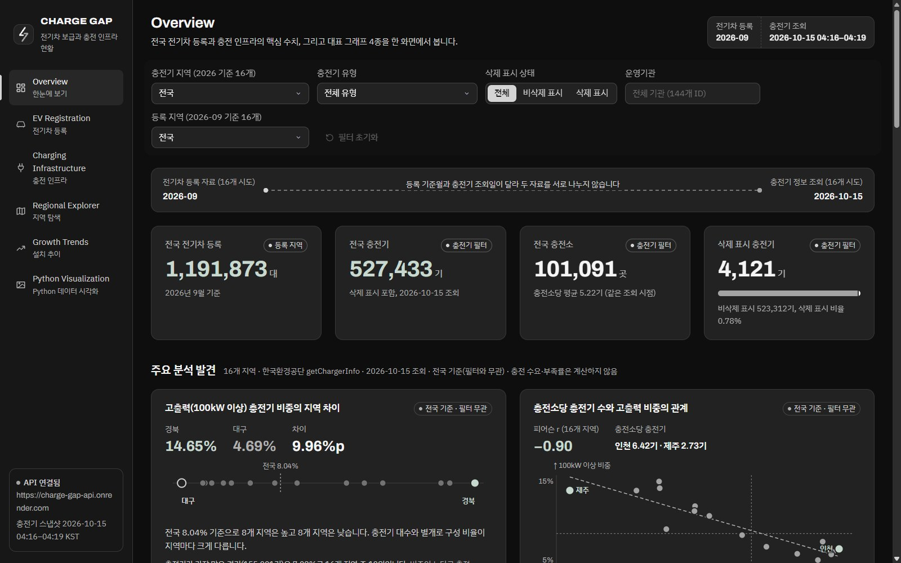
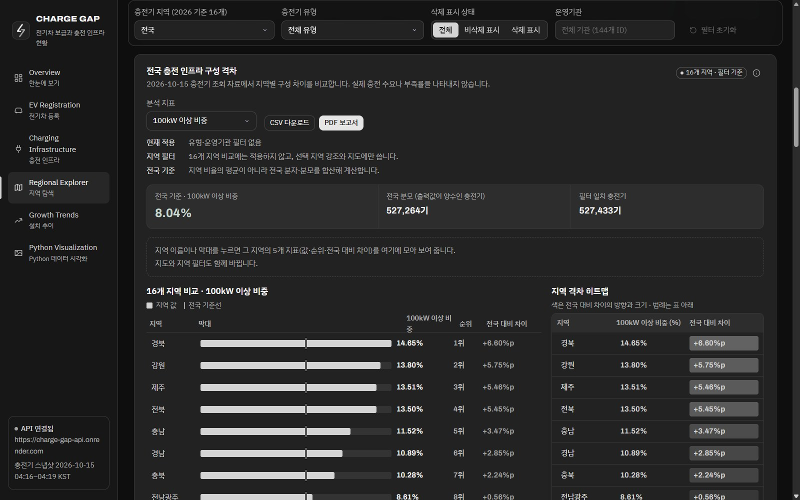
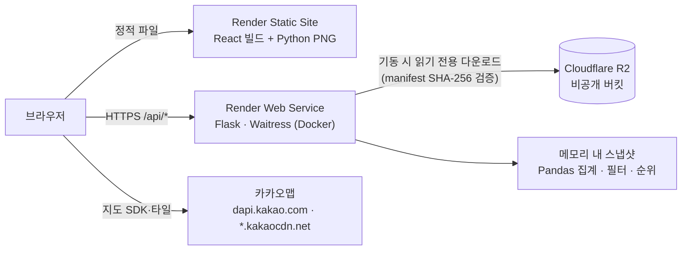

# CHARGE GAP

**전기차 보급과 충전 인프라의 지역별 격차를 분석하는 데이터 시각화 웹 대시보드**

국토교통부 전기차 등록 통계와 한국환경공단 충전기 정보 API를 바탕으로 16개 시도의 전기차 보급 현황과 충전 인프라 구성을 비교합니다. 지역마다 충전기의 유형·출력·운영기관 구성이 어떻게 다른지를 6개 페이지의 대화형 그래프, 지도, 보고서로 보여 줍니다.

| 웹사이트 | API | 소스 |
|---|---|---|
| [charge-gap.onrender.com](https://charge-gap.onrender.com) | [charge-gap-api.onrender.com](https://charge-gap-api.onrender.com/api/overview) | 이 저장소 (Public) |

> Render 무료 플랜이라 한동안 접속이 없으면 서버가 절전 상태가 됩니다. 첫 접속 때 서버가 데이터를 내려받아 준비하는 동안 몇 분까지 걸릴 수 있으며, 그동안 화면에 대기 안내가 표시되고 준비되면 자동으로 다시 불러옵니다.

### 핵심 요약

| | |
|---|---|
| **분석 규모** | 전기차 **1,191,873대** (2026년 9월) · 충전기 **527,433기** · 충전소 **101,091곳** (2026-10-15 조회) · **16개** 시도 |
| **페이지** | Overview · EV Registration · Charging Infrastructure · Regional Explorer · Growth Trends · Python Visualization |
| **분석 기능** | 두 지역 비교 · 16개 지역 충전 인프라 구성 격차(5개 지표, 히트맵) · CSV 내보내기 · A4 PDF 보고서 |
| **시각화** | 웹 대화형 그래프 10종(Recharts) + 충전소 지도(카카오맵 JavaScript SDK) + Python 고정 그래프 10종(Matplotlib·Seaborn) |
| **검증** | 백엔드·배포 테스트 312개, 프론트엔드 단위 테스트 160개, Python 그래프 수치 대조 50개 검사, 공개 사이트 실제 브라우저 점검 ([검증 기록](#검증-기록)) |

### 해결하려는 문제

전기차 등록 대수와 충전기 수는 각각 공개돼 있지만, **지역별 충전 인프라가 어떻게 구성돼 있는지**(급속 충전 비중, 충전소 규모, 운영기관 집중도 등)는 한눈에 비교하기 어렵습니다. CHARGE GAP은 공급 측 자료만으로 계산할 수 있는 구성 지표를 전국 기준값과 함께 보여 줍니다. 기준 시점이 다른 자료를 섞어 **충전 부족률이나 수요를 추정하지 않는 것**을 원칙으로 합니다.

## 목차

[미리보기](#미리보기) · [주요 기능](#주요-기능) · [데이터](#데이터) · [기술 스택](#기술-스택) · [시스템 구조](#시스템-구조) · [실행 방법](#실행-방법) · [검증 기록](#검증-기록) · [배포 상태](#배포-상태) · [문서](#문서)

## 미리보기

<table>
  <tr>
    <td width="50%"></td>
    <td width="50%"></td>
  </tr>
  <tr>
    <td align="center"><b>Overview</b> · 핵심 KPI와 대표 그래프</td>
    <td align="center"><b>지역별 충전 인프라 구성 격차</b> · 전국 기준선과 16개 지역 비교</td>
  </tr>
  <tr>
    <td width="50%"></td>
    <td width="50%"></td>
  </tr>
  <tr>
    <td align="center"><b>Regional Explorer</b> · 카카오맵 충전소 지도와 지역 요약</td>
    <td align="center"><b>Python Visualization</b> · Matplotlib·Seaborn 그래프 10종</td>
  </tr>
</table>

<sub>Overview·지역 격차·Python Visualization은 2026-11-05에 커밋 `6249b30`과 같은 소스를 로컬 프로덕션 빌드로 실행해 1600×1000으로 캡처했습니다(사이드바의 API 주소가 로컬 주소로 표시됨). Regional Explorer 지도는 2026-11-13 공개 사이트(커밋 `36ed7a6` 배포본)에서 1600×1000으로 촬영했으며, 지도의 카카오 로고·저작권 표시를 그대로 두었습니다.</sub>

## 주요 기능

### 6개 페이지

| 페이지 | 경로 | 주요 내용 | 분석 목적 |
|---|---|---|---|
| **Overview** | `/` | 전기차·충전기·충전소·삭제 표시 KPI 4개, 기준 시점 띠, 누적 설치·유형 도넛·충전소-충전기 산점도·지역별 등록 그래프, 자료 해석 기준 | 전체 규모와 자료의 기준 시점을 한 화면에서 파악 |
| **EV Registration** | `/ev-registration` | 지역별 등록 대수, 차종 구성, 사업용·비사업용 비율(100% 누적·대수 전환), 지역별 등록 표 | 전기차 보급의 지역 분포와 구성 |
| **Charging Infrastructure** | `/charging-infrastructure` | 충전기 유형 구성, 정격 출력 히스토그램·KDE(로그 축), 충전소당 충전기 수 박스플롯, 운영기관 트리맵·목록 | 충전기의 유형·출력·운영기관 구조 |
| **Regional Explorer** | `/regional-explorer` | 충전소 지도, 두 지역 비교, **전국 충전 인프라 구성 격차**(5개 지표), 지역×출력 히트맵, 지역 표, 충전소 목록 | 지역 간 충전 인프라 구성 비교 |
| **Growth Trends** | `/growth-trends` | 연간 설치 막대, 누적 설치 추이, 연도 구간 선택(빠른 선택 포함), 연도별 표 | 2011년 이후 설치 추이(2026년은 부분 연도) |
| **Python Visualization** | `/python-visualization` | Matplotlib·Seaborn 고정 그래프 10종 갤러리와 확대 보기(출처·기준일·지역 체계·삭제 기준·기법·라이브러리, 분석 결과, 해석 주의) | 웹 그래프와 같은 자료를 Python으로 재현·검증 |

### 분석 기능

- **필터와 URL 공유**: 충전기 지역·유형·삭제 표시 상태·운영기관과 등록 지역 필터를 URL 쿼리로 저장합니다. 페이지를 옮겨도 공통 필터가 유지되며, 잘못된 값은 무시하고 주소에서도 지웁니다.
- **지도 기반 충전소 탐색 (카카오맵)**: 줌 11 미만에서는 시도별 충전소 수를 원으로, 줌 11~15에서는 화면 영역(bbox) 안의 **모든** 충전소를 서버가 격자로 집계한 묶음(`/api/locations/grid`)을, 줌 16 이상에서는 개별 충전소(`/api/locations`, 1,000곳 단위·3페이지까지 자동)를 표시합니다. 충전소를 누르면 지도 정보창과 오른쪽 분석 패널에 같은 수치(일치 충전기·비삭제·삭제 표시)가 나타납니다. 표시는 지도 위 캔버스 한 장에 그려 많은 충전소도 가볍게 움직입니다. 원본 좌표 품질이 의심되는 충전소를 고르면 정보창과 패널에 안내 한 줄이 함께 나옵니다(점 위치·색은 그대로).
- **지역×출력 히트맵**: 16개 지역의 출력 구성을 `/api/charger-output/regions` **한 번의 요청**으로 받아 그리며, 분석 패널·두 지역 비교도 같은 결과를 재사용합니다(지역 필터와 무관하게 16개 지역 표시, 선택 지역 행 강조).
- **두 지역 비교**: 전기차 등록(2026-09)과 충전 인프라(2026-10-15)를 **같은 기준일 자료끼리만** 비교합니다(차이·%p·배수·순위). 등록 대수와 충전기 수를 서로 나눈 지표는 만들지 않습니다.
- **16개 지역 충전 인프라 구성 격차**: 아래 5개 지표를 전국 기준값(전국 분자·분모 합산)과 비교하고, 순위·막대그래프·히트맵·선택 지역 요약·계산 근거를 함께 보여 줍니다. 공급 측 **구성 지표**이며 충전 수요나 부족률을 계산하지 않습니다.

  | 지표 | 계산 |
  |---|---|
  | 100kW 이상 비중 | 100kW 이상 충전기 ÷ 출력값이 확인된 충전기 |
  | 충전소당 평균 충전기 | 충전기 수 ÷ 고유 충전소 수 |
  | 충전기 유형별 구성 | 선택 유형 충전기 ÷ 지역 충전기 |
  | 운영기관 집중도(HHI) | 운영기관별 점유율(%) 제곱의 합(0~10,000) |
  | 삭제 표시 비중 | 삭제 표시 충전기 ÷ 삭제 상태 전체 충전기 |

- **내보내기**: 현재 지표·필터의 16개 지역 표를 **CSV**(UTF-8 BOM, Excel 한글 호환)로 저장하고, A4 3페이지 **PDF 보고서**(핵심 요약 · 16개 지역 비교 · 계산 방법·주의사항·출처)를 브라우저 인쇄로 저장합니다.
- **그래프별 분석 문단**: 주요 그래프마다 분석 목적·그래프 선택 이유·주요 결과·해석·주의사항을 실제 API 응답으로 계산해 표시합니다. 그래프는 확대 보기와 데이터 표를 지원합니다.

### 웹 그래프 10종

| # | 그래프 | 표현 |
|---|---|---|
| 1 | 지역별 전기차 등록 대수 | 가로 막대 |
| 2 | 차종별 전기차 등록 구성 | 도넛 |
| 3 | 사업용·비사업용 구성 | 비율 점, 100% 누적·대수 보기 전환 |
| 4 | 지역별 충전소 수와 충전기 수 관계 | 산점도·회귀선 |
| 5 | 충전소당 충전기 수 분포 | 지역별 박스플롯 |
| 6 | 충전기 유형별 구성 | 도넛 |
| 7 | 충전기 정격 출력 분포 | 로그 축 히스토그램·KDE |
| 8 | 지역별 출력 구간 구성 | 비율 히트맵 |
| 9 | 연도별 누적 설치 추이 | 누적 영역 |
| 10 | 운영기관별 충전기 규모 | 트리맵 |

연간 설치량 막대와 충전소 지도도 제공합니다. [그래프 구성·API 연결](frontend/docs/CHART_PLAN.md)

### Python 그래프 10종 (Matplotlib · Seaborn)

`scripts/create_python_charts_2026.py`가 웹과 같은 자료로 그린 고정 PNG입니다. 정적 파일 `frontend/public/python-charts/`(PNG 10개 + `charts.json`)로 배포되며 웹사이트 필터와 무관합니다.

| # | 그래프 | 기법 | 라이브러리 |
|---|---|---|---|
| PY01 | 지역별 전기차 등록 대수 | 가로 막대 | Matplotlib · Seaborn barplot |
| PY02 | 차종별 전기차 등록 구성 | 도넛 | Matplotlib pie · Seaborn 테마 |
| PY03 | 지역별 사업용·비사업용 전기차 구성 | 100% 누적 가로 막대 | Matplotlib barh · Seaborn 테마 |
| PY04 | 지역별 충전소 수와 충전기 수의 관계 | 산점도 + OLS 회귀선 | Seaborn scatterplot·regplot · NumPy polyfit |
| PY05 | 지역별 충전소당 충전기 수 분포 | 박스플롯(1.5×IQR 이상치) | Seaborn boxplot · Matplotlib boxplot_stats |
| PY06 | 충전기 유형별 구성 | 도넛(상위 4개 + 기타) | Matplotlib pie · Seaborn 테마 |
| PY07 | 충전기 정격 출력 분포와 KDE | 히스토그램 + KDE(로그 축) | Seaborn histplot · SciPy gaussian_kde |
| PY08 | 지역별 충전기 출력 구간 구성 | 히트맵(행 기준 구성비) | Seaborn heatmap |
| PY09 | 연도별 누적 충전기 설치 추이 | 누적 영역 + 연간 막대 | Matplotlib fill_between · Seaborn lineplot |
| PY10 | 운영기관별 충전기 규모 | 트리맵(면적 비례) | Matplotlib patches · Seaborn 팔레트 |

`scripts/verify_python_charts_2026.py`가 그래프 계산값을 실행 중인 API와 대조합니다. 백엔드 `/api/charts`가 제공하는 보존용 PNG 10개(`outputs/charts/`)는 이 그래프와 별개의 이전 자료입니다.

## 데이터

| 항목 | 규모 · 기준 |
|---|---|
| 전기차 등록 | **1,191,873대**, 2026년 9월 말 등록 기준, 16개 지역 |
| 충전기 | **527,433기** (삭제 표시 4,121기 · 비삭제 표시 523,312기), 2026-10-15 조회 |
| 충전소 | **101,091곳** (고유 충전소 ID 기준) |
| 충전기 설치 추이 | 2011~2026년, **2026년은 부분 연도** |
| 지역 체계 | 2026년 16개 시도 (전남광주통합특별시 = 코드 12) |

### 데이터 출처와 해석 기준

| 자료 | 제공기관 · 작성기관, 자료명 | 자료 기준 · 수집 시점 · 이용 조건 |
|---|---|---|
| 전기차 등록 | [국토교통부 통계누리](https://stat.molit.go.kr/portal/cate/statMetaView.do?hFormId=1244&hRsId=58) · 작성기관 국토교통부, 「2026년 09월 자동차 등록자료 통계」 10.연료별_등록현황 (자동차등록현황보고) | 2026년 9월 말 등록 기준, 파일 저장 2026-10-20. 순수 전기차 1,191,873대, 전남광주 포함 16개 지역. **이용 조건 확인 중** (통계누리 저작권보호정책에 따라 출처 표시). 기존 2025-12 원본·고정 PNG 1~3번(17개 시도)은 기록으로 보존 |
| 충전기·충전소 | 한국환경공단 ([공공데이터포털](https://www.data.go.kr/data/15076352/openapi.do)), 「전기자동차 충전소 정보」 getChargerInfo | 2026-10-15 조회(04:16–04:19 KST), 충전기 527,433기·고유 충전소 101,091곳, 16개 지역. **공공누리 제1유형(출처표시)** — 포털 이용허락범위에 명시 |
| 연도별 설치 | [무공해차 통합누리집](https://ev.or.kr/nportal/stats/statsDashboard.do) 데이터·통계 「충전기 설치 성장 추세」, 작성기관 원본 미기재 | 2011–2026, 2026년은 부분 연도. 집계 마감일 원본 미기재(당시 공식 화면 갱신 표시 2026-09-30), 파일 저장 2026-10-15. **이용 조건 확인 중.** 공식 화면은 이후 2026-10-31 갱신에서 과거 연도 수치까지 수정했으며(사유 미확인), 이 프로젝트는 당시 자료를 유지하므로 2026년 누적 540,210기 등은 현재 공식 최신값이 아님 |
| 참고용 지역 출력 통계 | `우리 지역 급속 충전 여건_2026-10-15.xlsx` | 원본 대조·분석용. 웹 출력 히트맵은 API 집계 사용. 배포·R2에 포함하지 않음. 기준일·공개 조건 추가 확인 필요 |
| 지도 배경 | [카카오맵 API](https://developers.kakao.com/docs/latest/ko/kakaomap/common) (Kakao) | 데이터가 아닌 지도 서비스. JavaScript 키를 등록 도메인에서만 사용, 지도 위 카카오 로고·저작권 표시를 가리지 않음. 무료 쿼터(지도 Web SDK 일 300,000건) 안에서 사용 |

**해석 시 주의할 점**

- 전기차 등록(2026-09)과 충전기(2026-10-15)는 **16개 지역이 대응하지만 기준 시점이 다릅니다.** 서로 다른 시점으로 부족률을 계산하거나 현재 스냅샷을 2025년 12월 현황으로 해석하지 않습니다.
- 전남광주통합특별시를 광주·전남으로 임의 분리하지 않습니다.
- 삭제 표시 4,121기·비삭제 523,312기를 구분하고, 비삭제를 실제 이용 가능 상태로 해석하지 않습니다.
- `statUpdDt`는 상태 갱신일시이며 설치일이 아닙니다.
- 누적 설치 수는 선택한 연도 구간과 관계없이 2011년부터의 전체 누적값입니다.
- **충전소 좌표 품질**(2026-11-13 분석): 원본 대표 좌표 중 의심 근거가 있는 충전소가 **644곳, 충전기 3,322기(전체의 0.63%)**입니다.
  - 주소 시군구에서 100km 넘게 떨어진 좌표: 182곳
  - 여러 지역 충전소가 공유하거나 소수 1자리로 끊긴 대체·저정밀 좌표: 508곳
  - 두 기준에 모두 해당하는 46곳은 한 번만 셌습니다.
  - 644곳 모두가 실제 위치 오류로 확정된 것은 아닙니다. 외부 지오코딩 없이 주소·시군구 코드·이름·주변 충전소와의 모순으로만 판정했습니다. 대체·저정밀 좌표는 위치가 틀렸다기보다 대략적이라는 뜻입니다.
  - 지역별 통계는 좌표가 아니라 지역 코드로 집계하므로 영향이 매우 작습니다. 지역 코드가 틀렸을 수 있는 곳은 4곳, 충전기 6기입니다.
  - 영향은 주로 지도 위치에서 나타납니다. 일부 점이 다른 시도나 바다 위에 찍히거나 한 점에 겹칩니다.
  - 판정 기준과 전체 목록: [`reports/coordinate_quality_2026-11-13.md`](reports/coordinate_quality_2026-11-13.md)

### 공개 조건: 확인 필요

| 자료 | 이용 조건 (2026-11-13 공식 페이지 재확인) | 상태 |
|---|---|---|
| 충전기·충전소 (한국환경공단 API) | 공공데이터포털 이용허락범위 「공공저작물: 출처표시(제1유형)」 | 확인 |
| 전기차 등록 (통계누리) | 저작권보호정책은 출처 표시 조건의 자유 이용을 안내하지만, 공공누리 표시가 붙은 저작물인지 확인하라고 함. 해당 통계 페이지에서 공공누리 표시를 찾지 못함 | **미확정** |
| 충전기 설치 추이 (무공해차 통합누리집) | 공개자료 목록은 공공누리 제1유형이지만 설치 추이 표는 그 목록에 없고, 데이터·통계 화면에는 이용 조건 문구가 없음 | **미확정** |
| 참고용 지역 출력 통계 Excel | 출처 이용 조건 미확인. 배포·R2에 포함하지 않아 공개되지 않음 | 미확인(비공개) |
| 파생 그래프·보고서 | 입력 자료 조건을 따름. 전기차 등록·설치 추이로 만든 그래프(PY01–03·PY09, 보존 PNG 1–3·9)는 해당 자료 조건이 확정되어야 함 | 일부 미확정 |
| 지도 배경 (카카오맵) | 데이터가 아닌 지도 서비스. 등록 도메인에서 JavaScript 키 사용, 지도 캡처에는 카카오 로고 유지 | 사용 조건 확인 |
| 코드 | 저장소에 LICENSE 파일 없음 | 소유자 결정 필요 |

API 포털에는 확인 시점에 공공누리 제1유형 출처표시 조건이 안내됐으나, 이것으로 Excel·파생 CSV·PNG·보고서 전체의 재배포 권리를 일괄 확정하지 않습니다. 각 원본의 이용 조건·제3자 권리·출처와 가공 사실 표기를 검토해야 합니다. **CSV·Excel의 공개 여부, 별도 데이터 제공 URL, 전달 방식과 담당자는 모두 미확정**입니다. 코드 공개 라이선스도 소유자가 별도 결정해야 합니다. 후보에 남은 PNG·보고서도 최종 권리·내용 검토 대상입니다. 격차 분석 CSV에는 이용 조건이 확인된 충전기 API 자료의 집계값만 들어가며, PDF 보고서는 전기차 등록 자료를 결합하지 않고 참고 출처로만 표기합니다. 전기차 등록·연도별 설치 자료의 **이용 조건은 아직 미확인**입니다.

사이트가 공개 주소에서 동작한다는 사실이 데이터와 파생 그래프·보고서의 공개 이용 허락이 확정되었다는 뜻은 아닙니다. 상세 근거: [출처·이용 조건 확인 기록](docs/DATA_SOURCE_RIGHTS.md)

## 기술 스택

| 영역 | 기술 |
|---|---|
| Frontend | React · TypeScript · Vite · TanStack Query |
| Visualization | Recharts(웹) · Matplotlib · Seaborn(Python 그래프) |
| Map | 카카오맵 JavaScript SDK · Canvas 표시층(자체 구현) |
| Backend | Python · Flask · Waitress |
| Data Analysis | Pandas · NumPy |
| Deployment | Docker · Docker Compose · Nginx(로컬) · Render(Static Site + Web Service) |
| Storage | Cloudflare R2 (비공개 버킷, S3 호환) |

## 시스템 구조



| 구성 요소 | 역할 |
|---|---|
| **Render Static Site** | React 빌드(`frontend/dist`)와 Python 그래프 정적 파일을 제공합니다. 페이지 경로 5개(`/ev-registration` 등, `/python-visualization` 포함)는 `index.html`로 rewrite합니다. CSP 등 보안 헤더를 전송하며, CSP는 자체 파일·API와 카카오맵 SDK·지도 이미지 도메인만 허용합니다. |
| **Render Web Service** | Flask 조회 API **14개 경로**(JSON 13개 + PNG 1개, 지도용 `/api/locations/grid`와 히트맵용 `/api/charger-output/regions` 포함). 기동할 때 CSV를 읽은 고정 스냅샷으로 집계·필터·순위를 계산하고, 요청 값을 검증해 JSON 오류를 반환합니다. Render 무료 플랜 메모리(512MiB)에 맞춰 Waitress 1스레드로 실행합니다. |
| **Cloudflare R2** | CSV 3개·메타데이터·보존용 PNG 등 14개 파일을 비공개로 보관합니다. 백엔드만 읽기 전용 자격증명으로 접근하며, 프론트엔드 빌드에는 비밀값이 들어가지 않습니다. |

API 명세: [API_SPEC.md](backend/API_SPEC.md) · [openapi.json](backend/openapi.json). 환경변수 이름과 설정 절차는 [공개 배포 안내](docs/RENDER_DEPLOYMENT.md)에 있습니다(실제 값은 저장소에 기록하지 않습니다).

## 실행 방법

### 1. 데이터 준비 (필수)

**GitHub 저장소에는 실행용 데이터가 포함되지 않습니다.** `.gitignore`가 모든 CSV·Excel과 `.env`를 제외하므로, clone만으로는 실행되지 않습니다. 승인된 스냅샷을 아래 경로에 별도로 준비해야 합니다. 데이터 없이 시작하면 실패하며, 빈 폴더나 가짜 데이터를 대신 만들지 않습니다.

| 경로 | 용도 | 저장소 포함 |
|---|---|---|
| `data/processed/charger_info_clean.csv` | 전체 충전기, 약 240 MB | 제외 · 별도 준비 |
| `data/processed/ev_registration_by_region_2026_09.csv` | 전기차 등록 통계 | 제외 · 별도 준비 |
| `data/processed/charger_installation_trend.csv` | 연간·누적 설치 통계 | 제외 · 별도 준비 |
| `reports/chart_verification.json` | 보존용 PNG 메타데이터 | 포함 |
| `outputs/charts/` PNG 10개 | `/api/charts` 보존용 PNG | 포함 |

파일 목록과 SHA-256은 [`deploy/render/data-manifest.json`](deploy/render/data-manifest.json)에서 확인할 수 있습니다.

### 2. Docker Compose (로컬 전체 실행)

Docker Desktop(Linux 컨테이너) 또는 Docker Engine과 Compose v2가 필요합니다. 프로젝트 최상위 폴더에서:

```sh
docker compose up -d --build --wait --wait-timeout 240
```

접속: **http://localhost:18080** · 종료: `docker compose down`

구조는 `브라우저 :18080 → Nginx → /backend/ 프록시 → Waitress :5000`이며, CSV·PNG는 읽기 전용 바인드 마운트로 공급합니다. Compose 빌드에는 카카오맵 키를 전달하지 않으므로 **지도 자리에는 키 설정 안내가 표시**되고, 그래프·표·분석 패널은 그대로 동작합니다(지도까지 확인하려면 아래 개발 서버를 사용). Compose에는 인증키나 `env_file`이 없습니다. `.env`와 인증키를 컨테이너·빌드 인수·`VITE_*`로 전달하지 마세요. 자세한 내용: [Docker 검증 기록](docker/VALIDATION.md)

### 3. 개발 서버 (Python 3.12 · Node.js 24)

```powershell
# 터미널 1: 백엔드 (프로젝트 최상위 폴더에서)
cd backend
python -m venv .venv
.\.venv\Scripts\python.exe -m pip install -r requirements.lock.txt
.\.venv\Scripts\python.exe run.py

# 터미널 2: 프론트엔드
cd frontend
npm ci
npm run dev
```

웹 `http://localhost:5173`, API `http://127.0.0.1:5000`. Linux/macOS는 `python3 -m venv .venv`와 `.venv/bin/python`을 사용합니다. 자세한 내용: [백엔드](backend/README.md) · [프론트엔드](frontend/README.md)

**카카오맵 JavaScript 키 설정 (지도 표시에 필요)**

1. [카카오 Developers](https://developers.kakao.com/console/app)에서 앱을 만들고, 앱 설정의 **카카오맵 → 사용 설정**을 켭니다.
2. **앱 키**에서 **JavaScript 키**를 확인합니다. REST API 키·Admin 키는 사용하지 않습니다.
3. **플랫폼 → Web(JavaScript SDK 도메인)**에 실행 주소를 등록합니다: 로컬 `http://localhost:5173`, 배포 `https://charge-gap.onrender.com`.
4. `frontend/.env.example`을 `frontend/.env`로 복사하고 `VITE_KAKAO_MAP_KEY=<JavaScript 키>`를 적은 뒤 `npm run dev`를 다시 시작합니다. `frontend/.env`는 Git에서 제외됩니다.

JavaScript 키는 빌드 결과(JS)에 포함되어 브라우저에 공개되는 키이므로, 보호는 등록 도메인 제한으로 합니다. 키가 없거나 SDK를 불러오지 못하면 지도 자리에 원인 안내가 표시되고 나머지 화면은 그대로 동작합니다.

`npm run build`는 `VITE_API_BASE_URL`이 비어 있거나 localhost를 가리키면 **실패**합니다. 배포 빌드에는 실제 백엔드 HTTPS origin(또는 Compose의 `/backend`)을 지정하고, 로컬 미리보기 빌드만 `CHARGE_GAP_ALLOW_LOCAL_API_BUILD=1`을 함께 지정합니다.

### 4. Render 배포

Render Static Site(프론트엔드) + Docker Web Service(백엔드) + 비공개 R2 구성입니다. 환경변수 이름, SPA rewrite 5개, 보안 헤더, 배포 순서, 기동 실패 진단은 [공개 배포 안내](docs/RENDER_DEPLOYMENT.md)를 따릅니다. `render.yaml`은 자동 배포가 꺼져 있어(`autoDeployTrigger: 'off'`) push 뒤에 수동으로 배포해야 합니다.

- 정적 사이트 환경 변수: `VITE_API_BASE_URL`(백엔드 HTTPS origin), `VITE_KAKAO_MAP_KEY`(카카오 JavaScript 키, 값은 대시보드에만 입력), `NODE_VERSION=24`. VITE 값은 빌드할 때 들어가므로 바꾼 뒤에는 다시 빌드합니다.
- 새 API를 쓰는 프론트엔드를 배포할 때는 **백엔드를 먼저** 배포하고 API가 정상인지 확인한 뒤 프론트엔드를 배포합니다.

## 검증 기록

| 대상 | 명령 | 결과 | 기록 |
|---|---|---|---|
| 백엔드 API · Render 기동 스크립트 | `python -m pytest backend/tests deploy/render/tests -q` | **312 passed** (backend 227 · deploy 85, 좌표 품질 22개 포함) | 2026-11-14 실행 |
| 프론트엔드 단위·회귀 | `frontend`에서 `npm test` | **160개**: Git 저장소 밖 실행에서 159 통과 · 1 건너뜀(줄바꿈 검사). 건너뛴 줄바꿈 검사는 Git 저장소에서 따로 실행해 통과 | 2026-11-14 실행 |
| TypeScript · 프로덕션 빌드 | `npm run build` (배포 API 주소 지정) | 통과 | 2026-11-14 실행 |
| Python 그래프 수치 대조 | `python scripts/verify_python_charts_2026.py` | **50개 검사, 실패 0** (PNG 10개 SHA-256 포함) | 2026-11-14 실행 |
| 원본 CSV 재집계 대조 | 전기차·충전기·충전소·삭제 표시 수, 지역별 16행, 설치 추이 16행을 CSV에서 다시 세어 API와 비교 | 모두 일치 | 2026-11-05 실행 |
| 히트맵 통합 API | `backend/tests/test_charger_output_regions.py` | 16개 지역 × 40개 이상 필터 조합에서 기존 지역별 응답과 data·meta 동일, 원본 CSV 재계산과 일치 | 2026-11-14 실행(위 312개에 포함) |
| 데이터 수집기 | `python -m unittest test_collector -v` | 12 passed | 2026-11-14 실행 |
| 좌표 품질 안내 | `backend/tests/test_coordinate_quality.py`, `frontend/tests/coordinate-quality.*` | 508·182·46·644곳 재현, 보고서 목록 일치, 정상 행 응답·집계·캐시 불변, 브라우저 21개 확인(1440px·390px, 의심/정상 충전소 정보창·패널) | 2026-11-14 실행 |

**공개 사이트 실제 브라우저 점검 (Chrome · 커밋 `36ed7a6` 배포본, 2026-11-13)**

| 항목 | 결과 |
|---|---|
| 카카오맵 SDK·지도 타일 | SDK 로드, 지도 이미지 19개 모두 표시, 콘솔 오류 0 |
| 줌 11~18 | 서울·부산·제주 등에서 요청 범위가 화면을 모두 포함, 상태 줄 수 = API 집계, 개별 충전소 누락 0, 표시 위치 차이 0px |
| 충전소 클릭 | 정보창과 분석 패널 수치가 API와 일치 |
| 필터 | 지역·유형·삭제 표시·운영기관 조합에서 히트맵·패널 수치 = API |
| 히트맵 | `/api/charger-output/regions` 1회 요청, 16개 지역 표시, 지역별 개별 요청 0 |
| 화면 폭 390px | 가로 스크롤 없음, 범례·확대 버튼 겹침 없음 |
| 페이지·PNG | 6개 경로 직접 접속 200, Python 그래프 PNG 10개 표시·해시 일치 |

**브라우저 동작 검증 (Playwright · 커밋 `6249b30` 소스의 로컬 프로덕션 빌드, 2026-11-05)**

| 테스트 | 확인 내용 | 결과 |
|---|---|---|
| `direct-url.browser.cjs` | 6개 경로 직접 접근·새로고침·뒤로 가기, 자산 응답 유형(Render rewrite 규칙을 흉내 낸 로컬 서버) | 117개 확인 통과 |
| `disparity-report.browser.cjs` | PDF 보고서 5개 지표 × 지역 선택 여부, A4 정확히 3쪽, 표 잘림 없음, 전국값 일치 | 77개 확인 통과 |
| `growth-years.browser.cjs` | 연도 선택 제한·빠른 선택·잘못된 URL 정리·누적값 설명 | 27개 확인 통과 |
| `regional-disparity.browser.cjs` | 지역 격차 16개 지역 × 5개 지표 문장·URL 상태·범례 | 341개 확인 통과 |
| `keyboard` · `navigation` · `url-filters` · `card-layout` · `api-errors` · `map-explorer` · `server-wake` | 키보드 조작(59), 필터 유지(15), 잘못된 URL 정리(11), 카드 배치(68), API 오류 표시(8), 지도 확대·bbox(61), 서버 절전 복귀 6개 시나리오 | 통과 |
| `region-compare.browser.cjs` | 두 지역 비교 41개 확인 | 단독 실행 3회 모두 통과. 여러 테스트를 연속 실행했을 때 1회 「유형 필터 변경 후 수치 갱신」 확인에서 실패(대기 시간 문제로 추정, 원인 미확정) |
| Python Visualization | 1920·1440·768·390px에서 4·3·2·1열, PNG 10개 로드, 확대 창 10개(닫기·Escape), 가로 스크롤 없음 | 통과 |

카카오맵 전환 후 추가한 `heatmap-merge.browser.cjs`(히트맵 통합 25개 확인)와 `map-panel-edge.browser.cjs`(가장자리 충전소·분석 패널 163개 확인)는 2026-11-12~13 로컬 프로덕션 빌드에서 통과했습니다. `map-explorer.browser.cjs`·`map-transitions.browser.cjs`는 카카오맵 기준으로 바뀐 뒤의 실행 기록을 이 문서에 남기지 않았습니다.

브라우저 테스트는 Playwright `page`를 받는 모듈입니다(`await require('./frontend/tests/navigation.browser.cjs')(page, baseUrl)`). Playwright는 프로젝트 의존성에 포함하지 않았습니다. 카카오맵 SDK 요청은 `frontend/tests/fixtures/kakao-maps-stub.js`로 대신합니다.

**아직 확인하지 않은 항목**: Windows 인쇄 대화상자로 저장한 PDF 실파일, 공개 사이트에서의 CSV·PDF 저장, Firefox·Safari·실제 모바일 기기(390px는 화면 크기 흉내로만 확인), Lighthouse 성능, Render 무료 플랜의 실제 메모리 그래프(유료 플랜 전용).

## 배포 상태

2026-11-13 기준입니다.

| 구분 | 내용 | 근거 |
|---|---|---|
| 배포 소스 | 백엔드 → 프론트엔드 순서로 모두 커밋 `36ed7a6` 배포 성공 | Render 배포 기록 |
| 백엔드 공개 주소 | R2 파일 14개 해시 검증 후 Waitress 1스레드로 기동. `/api/charts`·`/api/charger-output/regions`(16개 지역)·`/api/locations/grid` 200, 잘못된 요청은 JSON 400/404 | 배포 로그·브라우저에서 직접 확인(읽기 전용) |
| 프론트엔드 공개 주소 | 6개 경로 직접 접근 200, 카카오맵 표시, `/python-charts/charts.json`·PNG 10개 200, 없는 경로는 404, 보안 헤더(CSP·X-Frame-Options·Referrer-Policy·HSTS·nosniff) 전송 | 브라우저에서 직접 확인(읽기 전용) |

커밋 작성자 이메일을 GitHub noreply 주소로 바꾸면서 이력의 커밋 해시가 바뀌었습니다. Render 배포 기록에 표시될 수 있는 이전 해시 `644b938`은 현재 `6249b30`과 파일 내용(트리)이 같은 커밋입니다.

공개 사이트의 PNG는 CDN 이미지 최적화를 거쳐 전송되므로 파일 바이트가 저장소 원본과 다릅니다(이미지 크기는 같음). Render 대시보드의 환경변수 값과 R2 객체 자체는 저장소 밖이라 이 문서에서 확인하지 않았습니다.

## 프로젝트 구조

```text
backend/                  Flask API · 테스트 · API 명세 · Dockerfile
frontend/                 React 앱 · 그래프 · 지도 · Nginx 설정 · Dockerfile
  public/python-charts/   Python 고정 그래프 PNG 10개 + charts.json
deploy/render/            Render 백엔드 Dockerfile · R2 다운로드 · data-manifest.json
scripts/                  Python 그래프 생성·검증 코드
reports/                  분석 · 데이터 품질 · 그래프 · 배포 검증 보고서
outputs/charts/           /api/charts 보존용 PNG 10개
docs/                     배포 안내 · 데이터 출처·이용 조건 · GitHub 공개 준비
docker/                   Docker 실행 검증 기록
data/                     로컬 CSV·Excel (Git 제외)
compose.yaml              로컬 전체 실행 (포트 18080)
render.yaml               Render 서비스 정의 (수동 배포)
```

## 보안

- `.gitignore`가 `.env`·인증키 파일·가상환경·`node_modules`·캐시·로그·임시 파일과 **모든 CSV·Excel**을 제외합니다. `.env.example`에는 비밀값 없는 공개 설정 예시만 둡니다.
- R2 endpoint·자격증명은 Render 서버 환경 설정에만 입력하며 `VITE_*`나 코드에 넣지 않습니다. 기동 스크립트는 데이터를 내려받은 뒤 Flask 프로세스를 띄우기 전에 R2 환경 변수를 지웁니다.
- 프론트엔드에 들어가는 값은 공개 API 주소와 카카오맵 **JavaScript 키**뿐입니다. JavaScript 키는 원래 브라우저에 공개되는 키이며 카카오 개발자 콘솔에 등록한 도메인에서만 동작합니다. REST API 키·Admin 키는 사용하지 않습니다.
- 정적 사이트는 CSP(`script-src`는 자체 파일과 카카오맵 SDK 도메인만, 인라인 스크립트·스타일과 eval 없음)·X-Frame-Options·Referrer-Policy·HSTS 헤더를 보냅니다.
- 이미 추적된 파일은 `.gitignore`만으로 제외되지 않으므로, 파일을 추가할 때는 `git add .` 대신 경로를 지정하고 `git status`로 확인합니다.

## 문서

| 문서 | 내용 |
|---|---|
| [docs/RENDER_DEPLOYMENT.md](docs/RENDER_DEPLOYMENT.md) | Render·R2 배포 설정, 환경변수, SPA rewrite, 보안 헤더, 배포 순서, 기동 실패 진단 |
| [docs/DATA_SOURCE_RIGHTS.md](docs/DATA_SOURCE_RIGHTS.md) | 데이터 출처 표기 원칙과 공개 이용 조건 확인 기록 |
| [docs/GITHUB_READINESS.md](docs/GITHUB_READINESS.md) | GitHub 공개 준비 점검과 제외 규칙 |
| [backend/API_SPEC.md](backend/API_SPEC.md) · [openapi.json](backend/openapi.json) | API 14개 경로 명세 |
| [backend/README.md](backend/README.md) · [frontend/README.md](frontend/README.md) | 백엔드·프론트엔드 실행과 구조 |
| [frontend/docs/CHART_PLAN.md](frontend/docs/CHART_PLAN.md) | 웹 그래프 10종 구성과 API 연결 |
| [reports/dataset_analysis.md](reports/dataset_analysis.md) · [reports/chart_analysis.md](reports/chart_analysis.md) | 데이터 분석, 그래프 분석 |
| [reports/r2_cache_memory_optimization_2026-10-19.md](reports/r2_cache_memory_optimization_2026-10-19.md) | Render 무료 플랜 메모리 측정(512MiB·R2 다운로드 포함) |
| [reports/github_render_final_readiness_2026-10-19.md](reports/github_render_final_readiness_2026-10-19.md) | 2026-10-19 배포 준비 기록 |
